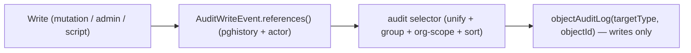
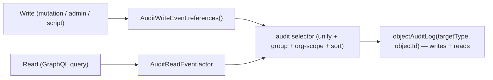
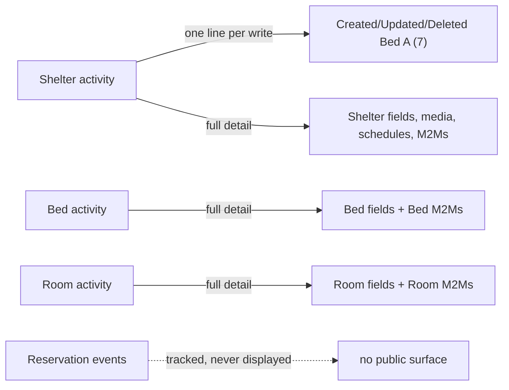

# ADR 0004: Shelter audit log

## Status

Accepted. Phase 1 (write tracking) and Phase 2 (the write audit log) are
implemented, including the review follow-ups: cursor pagination with a
total-order cursor, `across()` branch pruning, raw-column page predicates (only
the context arm is indexable), a per-page event budget, retention scoped to
`--apps` with per-object boundary rows, and the complete `ContactInfo` read
exclusion.

## Context

Every action in the shelter operator portal must be auditable: any time a user
touches any object, there is an event record. Writes are tracked with
[pghistory](https://github.com/Opus-10/django-pghistory) (database triggers via
`pgtrigger`); reads cannot be trigger-captured and are tracked at the GraphQL
layer via a Strawberry extension.

Tracking is opt-in via `@pghistory.track(...)` decorators. pghistory uses
`pgtrigger` to install PostgreSQL triggers, so events fire at the DB level for
every INSERT/UPDATE/DELETE (including `bulk_create` and queryset deletes). The
`HistoryMiddleware` (`pghistory.middleware.HistoryMiddleware`, already in
`MIDDLEWARE`) attaches the acting user to in-request writes. The gaps are
missing decorators, one conditional update event, and a read path that has no
trigger to fire.

Most reporting consumers are unaffected: the selectors that filter on a single
`pgh_label` (`bed.add`, `reservation.status_change`, etc. in
[shelters/selectors/reports.py](apps/betterangels-backend/shelters/selectors/reports.py))
ignore the new labels. `_reservation_status_intervals` (used by
`report_bed_status_counts` and `daily_occupancy`) walks status transitions and
scopes `reservation.update` out. Because §2 makes the two update conditions
**disjoint** (for a single save as well as across saves), that scope no longer
guards against a replayed status change — it is retained defensively, because it
also keeps a non-status bed reparent out of the walk. §2 documents the reasoning
and adds the regression test.

## Deliverables (phased)

Writes are landed and queryable end-to-end before the read path is touched, so
the high-value "who changed this object" surface ships first and the novel,
riskier read mechanism is deferred.

- **Phase 1 — Track writes.** Every model that can be touched in the operator
  portal (and everything a Shelter touches, including admin-managed models)
  emits insert/update/delete events, with actor identity frozen at write time.
- **Phase 2 — Audit writes.** The write-only `objectAuditLog`: selector, types,
  query, authorization, and attribution.
- **Phase 3 — Filters.** Date-range and actor filters on the write audit log.
- **Phase 4 — Track reads.** Single-object read ("view") events are recorded at
  the GraphQL layer (list reads deferred).
- **Phase 5 — Audit reads & writes.** Merge reads into the selector; the audit
  log now shows both change and read events.
- **Phase 6 — Update filters.** The event-kind filter, meaningful once reads
  exist.
- **Phase 7 — Retention.** The `purge_audit_log --before` management command
  (§31).

---

# Phase 1 — Track writes

> **Snapshot noise (mechanical columns):** pghistory snapshots all model fields
> by default, including `BaseModel.created_at`/`updated_at` (`auto_now_add`/
> `auto_now`). `updated_at` changes on every save, so a bare `*.update` event
> (no condition) would fire on every `.save()` and render a phantom `updated_at`
> diff. The `field_changes` rendering (§13) must therefore **exclude
> `created_at`/`updated_at`** (and any `pgh_*` keys), the same way the aggregate
> SQL already filters `pgh_*`. For the _new_ event tables created in this phase,
> alternatively pass `exclude=["created_at", "updated_at"]` to the decorator;
> **do not** change the existing `Reservation` decorator's snapshot _shape_ (it
> would drop columns from `reservation.status_change`, which the report selectors
> already consume). For `Reservation.update` the mechanical column is excluded
> from the trigger _condition_ instead — not the snapshot — so the trigger fires
> only on real changes (§2). `pgh_created_at` is the event's own timestamp and is
> unaffected either way.

## 1. Track `Room` (currently untracked)

In [shelters/models/shelter.py](apps/betterangels-backend/shelters/models/shelter.py), add the same decorator Bed uses, above `class Room`:

```python
@pghistory.track(
    pghistory.InsertEvent("room.add"),
    pghistory.UpdateEvent("room.update"),
    pghistory.DeleteEvent("room.remove"),
)
class Room(CloneMixin, OrgScoped, BaseModel):
```

## 2. Track all `Reservation` updates (currently status-only)

In [shelters/models/reservation.py](apps/betterangels-backend/shelters/models/reservation.py), add a second update event whose condition is **disjoint** from the existing `status_change`, so every write emits exactly one row:

```python
class _NonStatusChange(pghistory.AnyChange):
    """Any tracked field changed, and ``status`` did not."""

    def resolve(self, model: type[models.Model]) -> str:
        status = model._meta.get_field("status").column
        return f'(({super().resolve(model)}) AND OLD."{status}" IS NOT DISTINCT FROM (NEW."{status}"))'


@pghistory.track(
    pghistory.InsertEvent("reservation.add"),
    pghistory.DeleteEvent("reservation.remove"),
    pghistory.UpdateEvent("reservation.status_change", condition=pghistory.AnyChange("status")),
    pghistory.UpdateEvent("reservation.update", condition=_NonStatusChange(exclude=["status", "updated_at"])),
)
```

`reservation.status_change` exists to feed the reporting selectors; `reservation.update` covers every other change. Because the conditions are mutually exclusive, every write emits **one** event: `status_change` when `status` changed — carrying the whole write's diff, including `checked_in_at`/`notes` set in the same save — and `update` otherwise.

> **Why `updated_at` is excluded.** `BaseModel.updated_at` is `auto_now`, so it changes on every `save()`. Leaving it in makes `reservation.update` match every write, including a bare status change. (Only `updated_at` churns — `created_at` is `auto_now_add` and never changes on update.)

> **Why `update` also requires `status` to be unchanged.** `AnyChange(exclude=["status", "updated_at"])` is not disjoint on its own — it only excludes `status` from the _change test_, so a single save that changes `status` and another field matches both triggers. The check-in/check-out path does exactly that: `reservation_update` sets `status` and `checked_in_at`/`checked_out_at` together ([shelters/services/reservation.py](apps/betterangels-backend/shelters/services/reservation.py)). Both triggers then insert the same `NEW` snapshot; the aggregate diffs a row against the previous event of the _object_ (any label, so `_prev_data` is not per-label), leaving the second row with `pgh_diff = NULL` and a phantom audit event. Gating `update` on `OLD.status IS NOT DISTINCT FROM NEW.status` is what makes the pair genuinely disjoint, and it removes any dependence on trigger firing order. Asserted by `test_reservation_status_and_notes_update_fires_one_label_with_full_diff` and `test_check_in_writes_exactly_one_event`.

**Reporting:** `_reservation_status_intervals`
([shelters/selectors/reports.py](apps/betterangels-backend/shelters/selectors/reports.py))
walks status transitions and filters `pgh_label__in=["reservation.add",
"reservation.status_change"]`. With disjoint conditions a `reservation.update`
can never carry a status, so this scope is no longer load-bearing — it is
retained **defensively**, because it also keeps a non-status bed reparent out of
the walk. That reparent is the reason to keep it: an `update` that changes
`bed_id` without changing `status` snapshots the new bed, the
consecutive-duplicate dedup does **not** skip it (`bed_id` differs), and the
open/close logic keys only on status — so surfacing it would open/close intervals
against the wrong bed. **`reservation.add` must be retained** — the interval walk
relies on the INSERT snapshot to open intervals for reservations created directly
in a target status (`created_as` in the test helper, mirroring bulk/admin
creation), where no `status_change` event exists
([test_selectors.py:386](apps/betterangels-backend/shelters/tests/test_selectors.py)
`test_created_directly_as_checked_in_is_counted`). Scoping to `status_change`
alone would drop `add`, never open that interval, and undercount occupancy.
`reservation.remove` (DELETE) is inert here — its snapshot duplicates the
preceding status, so the dedup already skips it. Keep a regression test asserting
`report_bed_status_counts`/`daily_occupancy` output is unchanged when a non-status
update fires (and when a status+notes update fires), and that the directly-created
path still counts.

**Latent bed-reparent edge case (separate):** as above, the interval open/close
logic keys only on status transitions and does not close the interval on the old
bed when `bed_id` changes without a status change. Pre-existing; the label scope
keeps it latent. Asserted (not fixed) by
`test_reparent_without_status_change_pins_current_behaviour`, so a future
refactor of `_reservation_status_intervals` renders the change visible rather
than silently altering a wrong path.

## 3. Track `ReservationClient` (currently untracked)

Same file, decorate `class ReservationClient`. The service creates/deletes these rows directly via `ReservationClient.objects.create(...)` / `.delete()` in `_set_clients` ([shelters/services/reservation.py](apps/betterangels-backend/shelters/services/reservation.py)), so concrete-model tracking captures them:

```python
@pghistory.track(
    pghistory.InsertEvent("reservation_client.add"),
    pghistory.UpdateEvent("reservation_client.update"),
    pghistory.DeleteEvent("reservation_client.remove"),
)
class ReservationClient(BaseModel):
```

## 4. Track `ShelterPhoto` (currently untracked)

In [shelters/models/media.py](apps/betterangels-backend/shelters/models/media.py), decorate `class ShelterPhoto`. Its `InteriorShelterPhoto`/`ExteriorShelterPhoto` proxies share the same DB table, so their saves are captured by the same triggers:

```python
@pghistory.track(
    pghistory.InsertEvent("shelter_photo.add"),
    pghistory.UpdateEvent("shelter_photo.update"),
    pghistory.DeleteEvent("shelter_photo.remove"),
)
class ShelterPhoto(OrgScoped, BaseModel):
```

## 5. Track the remaining admin-managed models

Everything a Shelter touches must be tracked, including the models edited
through Django admin. Add `@pghistory.track` (add/update/remove) to:

- `MediaLink`, `Video` — [shelters/models/media.py](apps/betterangels-backend/shelters/models/media.py)
- `Service`, `ServiceCategory` — [shelters/models/service.py](apps/betterangels-backend/shelters/models/service.py)
- All lookup/catalog models in [shelters/models/lookups.py](apps/betterangels-backend/shelters/models/lookups.py): `Demographic`, `SpecialSituationRestriction`, `ShelterType`, `RoomStyle`, `Accessibility`, `Storage`, `Pet`, `Parking`, `EntryRequirement`, `VaccinationRequirement`, `City`, `SPA`, `ShelterProgram`, `Funder`, `ExitPolicy`, `ReferralRequirement`, `MedicalNeed`.

Note: `_set_m2m_from_enums` ([shelters/services/utils.py](apps/betterangels-backend/shelters/services/utils.py)) does `get_or_create` on these lookup rows whenever a shelter/bed/room M2M is set, so a new lookup value introduced through an operator mutation will also emit a lookup `add` event — correct, since "everything that touches a Shelter" includes the lookup rows it creates.

## 6. Track many-to-many joins (through-table proxies)

Extend [shelters/models/tracked.py](apps/betterangels-backend/shelters/models/tracked.py) (or a sibling file) with proxy models for the through tables that are not covered today, using the existing `obj_field=None` pattern:

- Shelter missing joins: `exit_policy`, `referral_requirement`, `services`
- Bed joins (5): `accessibility`, `demographics`, `funders`, `medical_needs`, `pets`
- Room joins (4): `accessibility`, `demographics`, `funders`, `pets`

**Proxy naming scheme (must be stated to avoid collisions):** four related models
(`Accessibility`, `Demographic`, `Funder`, `Pet`) are M2M targets on Shelter, Bed,
_and_ Room, and the existing Shelter proxies already claim the unprefixed
`Tracked<Related>` names (`TrackedAccessibility`, `TrackedDemographic`,
`TrackedFunder`, `TrackedPet` in
[shelters/models/tracked.py](apps/betterangels-backend/shelters/models/tracked.py)).
Adopt: **existing/new Shelter proxies keep `Tracked<Related>`
(`TrackedExitPolicy`, `TrackedReferralRequirement`, `TrackedService`); Bed and
Room proxies are parent-prefixed `Tracked<Parent><Related>`
(`TrackedBedAccessibility`, `TrackedRoomAccessibility`, …)**. This also fixes the
§19 `pgh_model` labels, which are derived from the class names.

Example (one per field):

```python
@pghistory.track(
    pghistory.InsertEvent("bed.medical_need.add"),
    pghistory.DeleteEvent("bed.medical_need.remove"),
    obj_field=None,
)
class TrackedBedMedicalNeed(Bed.medical_needs.through):
    class Meta:
        proxy = True
```

Re-export the new proxies from [shelters/models/**init**.py](apps/betterangels-backend/shelters/models/__init__.py) to keep imports consistent.

## 7. Generate the migration

Run `python manage.py makemigrations shelters` (from `apps/betterangels-backend`). This emits `pgtrigger` `AddTrigger` operations for the new event tables/triggers (mirroring how the initial migration adds `reservation_add_insert`, `bed_add_insert`, etc.).

## 7b. Suppress seed / import / clone noise

**Goal.** Once §1–§6 land, every INSERT/UPDATE/DELETE — including `bulk_create`,
`bulk_update`, queryset `.delete()`, and individual `.save()`/`.set()` — fires a
row trigger. That means routine, non-operator writes (lookup seeding, demo-data
generation) would otherwise flood the event tables with hundreds of "system"
rows per run and pollute every object's audit log. Each such source is wrapped
in `pghistory.context(label=...)` so the events are _marked_ with a reason. Two
of the sources — admin clone and admin CSV import — are **operator** actions
through the portal/admin, so their events must be **kept and rendered**
("system (clone)" / "system (import)", §11); only the two non-operator seed
sources are **excluded** from the log. This split avoids both noise _and_ a
silent audit hole where import/clone could mutate Shelter/Bed/Room/ShelterPhoto
rows with no trail.

The label is stored on the `Context` row's `metadata` JSON — not on the event
row itself — so filtering/rendering operates on the context (`pgh_context__label`),
not on `pgh_label` (the event label like `shelter.add`). See §11 for how the
selector exposes `label` as a filterable proxied field.

There are **four** write sources to wrap with a reason label, in two files:

### 7b.1 Lookup seed (`post_migrate`)

File: [shelters/seed.py](apps/betterangels-backend/shelters/seed.py), entry point
`seed_shelter_lookups()`, wired to `post_migrate` in
[shelters/apps.py](apps/betterangels-backend/shelters/apps.py).

This seeds the lookup models §5 newly tracks (`SPA`, `City`, `Service`,
`ServiceCategory`) via `SPA.objects.bulk_create(...)`, `City.objects.bulk_create(...)`,
and `ServiceCategory`/`Service.objects.bulk_create(...)` — each with
`ignore_conflicts=True`. There is no request/middleware here, so `label` is the
only context metadata.

Wrap the single entry point (the three helpers already early-return when the
table is non-empty, so re-running `migrate` on a warm DB is a no-op):

```python
def seed_shelter_lookups() -> None:
    with pghistory.context(label="seed"):
        seed_spas()
        seed_cities()
        seed_services()
```

Add `import pghistory` at the top of `seed.py`.

### 7b.2 Demo-shelter seed script

File: [shelters/scripts/seed_shelters.py](apps/betterangels-backend/shelters/scripts/seed_shelters.py),
`main()`. Runs standalone (`if __name__ == "__main__"`), so again no middleware
context.

Inside `with transaction.atomic():` it performs `Shelter.objects.all().delete()`
(under `--clear`), `make_complete_shelters(...)` (baker `.create()`/`.save()`/
`.set()`), `Shelter.objects.bulk_update(...)`, per-shelter `.save()` for
geocoding, `_add_images(...)` (`ShelterPhoto.objects.create(...)` +
`.save(update_fields=["hero_image"])`), and `shelter_contact_recipe.make(...)`.

Wrap the whole `transaction.atomic()` block (it is the top-level body of
`main()`, and every write happens inside it):

```python
with pghistory.context(label="seed"):
    with transaction.atomic():
        ...
```

Add `import pghistory` at the top of `seed_shelters.py`.

### 7b.3 Admin clone (`clone_view`)

File: [shelters/admin.py](apps/betterangels-backend/shelters/admin.py), `clone_view`
(`ShelterAdmin`, ~line 1405). Inside `with transaction.atomic():` it calls
`shelter_copy.save()`, then `_clone_many_to_many_fields` (`.set()` per M2M field),
`_clone_related_contacts` (`contact.save()`), and `_clone_related_photos_and_videos`
(`obj.save()` per photo/video).

Wrap the transaction block:

```python
with pghistory.context(label="clone"):
    with transaction.atomic():
        # existing clone body
```

### 7b.4 Admin CSV import (`ShelterResource`)

File: [shelters/admin.py](apps/betterangels-backend/shelters/admin.py), `ShelterAdmin`
(`ImportExportModelAdmin`, ~line 950) with `resource_class = ShelterResource`
(~line 1151). `django-import-export` is **4.4.1**; the write path is
`ImportMixin.process_import` → `process_dataset` → `resource.import_data(...)`
(instance saves and M2M saves all happen inside `import_data`).

Override `process_dataset` on `ShelterAdmin` — the tightest single method that
wraps every DB write of the import — rather than the broader `process_import`
view (which also renders the confirm/dry-run form that performs no writes):

```python
def process_dataset(self, dataset, form, request, **kwargs):
    with pghistory.context(label="import"):
        return super().process_dataset(dataset, form, request, **kwargs)
```

Add `import pghistory` at the top of `admin.py` (it already imports
`from pghistory.models import MiddlewareEvents`).

### Merge semantics, label precedence, and context leak (clone + import)

`pghistory.context()` **merges** its metadata into any enclosing context
(`runtime.py:191` does `_tracker.value.metadata.update(**self.metadata)`); it does
not replace it. `clone_view` and the CSV import both run inside an admin
request, so the `HistoryMiddleware` context (carrying `user`) is already active:
their events carry **both** `user` and `label` in one context. The selector
**prioritizes `label` over `user`** when rendering the actor reason — an event
with `label="import"` renders "system (import)" even though an operator
triggered the import — but it does **not** exclude these events (§11).

**Context leak (documented, accepted):** a nested `pghistory.context()` mutates
the parent metadata in place and `__exit__` restores nothing
(`runtime.py:190-191`, `runtime.py:204-207`). After the
`with pghistory.context(label="import")` block exits, `label="import"` persists
for the remainder of the request, so any write later in the same admin request
(e.g. `django-import-export`'s post-import log-entry writes) also carries the
label. This is acceptable because import/clone events are kept and attributed
(not excluded). If a future exclusion ever depends on `label` alone, snapshot/
restore `_tracker.value.metadata` around the block.

The two seed sources (§7b.1, §7b.2) have no enclosing context, so `label` is
their only metadata; their events render "system (seed)" and are excluded.

### 7b.5 Operator paths already attributed (not wrapped)

These writes run under the `HistoryMiddleware` context (so they already carry
`user`) and need no reason label; the selector renders them normally:

- `ShelterAdmin` M2M handling bulk-creates missing lookup choices
  ([shelters/admin.py:397](apps/betterangels-backend/shelters/admin.py)).
- `ShelterAdmin.save_formset` creates `Schedule` rows directly
  ([shelters/admin.py:1252](apps/betterangels-backend/shelters/admin.py)).
- `common/management/commands/seed_data.py` calls `seed_shelter_lookups()`,
  which is itself wrapped per §7b.1, so the `seed` label still applies there.
- **Client merge/undo.** `merge_execute` bulk-reassigns every FK pointing at the
  source `ClientProfile` via `get_fk_relations()`
  ([clients/selectors/merge.py:114](apps/betterangels-backend/clients/selectors/merge.py)),
  which includes `ReservationClient.client_profile` — so a merge re-points
  reservation-client rows ([clients/services/merge.py:306](apps/betterangels-backend/clients/services/merge.py)),
  and `merge_undo` reverses it ([clients/services/merge.py:517](apps/betterangels-backend/clients/services/merge.py)).
  Both run inside the admin merge request
  ([clients/admin_merge.py:241](apps/betterangels-backend/clients/admin_merge.py)),
  so the middleware supplies `user` — this is not an attribution bug. Without a
  label the operation renders as an ordinary user edit, which is _correct_ but
  loses the fact that a bulk reassignment moved reservations. `merge_execute`
  already takes `performed_by`, documented `# reserved for future audit logging`;
  if merge is later given its own label (as `clone`/`import` are, §7b.3/§7b.4),
  that parameter is the natural hook.

These produce attributed events with no `label`; the selector's actor/label
precedence must not render them "system" when a `user` is present.

### 7b.6 Sensitive fields retained on the table, excluded from the log (`ContactInfo`)

`ContactInfoEvent` snapshots `contact_name`, `contact_number`, and
`contact_email` ([shelters/models/shelter.py](apps/betterangels-backend/shelters/models/shelter.py))
on every write, into an append-only-by-convention event table. The rows are
retained deliberately: keeping every tracked-model field on the event preserves
`Event.can_revert()` for `ContactInfo`, which requires the full snapshot
(`pghistory/models.py`). `contact_title`/`is_claimant` are non-sensitive and
retained for the same reason.

The **read path excludes the model entirely.** `ContactInfo` is internal Better
Angels data with no end-user surface, and `objectAuditLog` is an operator-facing
surface whose history spans every event model referencing a shelter. Rendering
those snapshots would expose staff names, emails, and phone numbers to every
holder of `Shelter.VIEW` — including a caller who cannot open the contact record
itself. Rather than gate the rows behind a per-caller permission check (which
still leaves them one permission-grant away from exposure), the model is in
`_EXCLUDED_EVENT_MODELS` for *all* callers and *all* targets, and `across()`
drops its UNION branch so the table is not even read (§10). This is a
read-side exclusion only: writes are still tracked, so lookups and `can_revert`
work as before. (If client PII is ever tracked into an event table, this
decision does **not** extend to it — see the retention/open-items notes.)

### Test coverage

Add to §9: after a wrapped run, the emitted events carry the expected context
label — `seed_shelter_lookups()` (on cleared tables) yields events with
`pgh_context` metadata `{"label": "seed"}` and no `user`; a `clone_view` POST
yields events whose context has `label == "clone"` **and** the admin `user`; a
CSV import yields `label == "import"`. §20 asserts the retention split: seed
events are excluded from `objectAuditLog`, while clone/import events remain
visible and attributed.

## 8. Freeze actor identity on writes

Attribution is easy to get wrong: resolving the event's user id against the
_current_ `User` row — or rendering `user.get_full_name()` — lets a rename
silently rewrite history and a delete null it out. pghistory does not perform
that join itself: the aggregate projects the id straight out of the context
metadata (`(_pgh_context.metadata->>'user')::bigint`), so the id is already
frozen at write time. Identity is nevertheless frozen **more completely** on the
write path by snapshotting the acting user's name/email into the same metadata,
so display never depends on resolving the id at read time.

Subclass `pghistory.middleware.HistoryMiddleware`, point `MIDDLEWARE` at it, and
override `get_context` to add the acting user's frozen name/email to the context
metadata:

```python
class HistoryMiddleware(pghistory.middleware.HistoryMiddleware):
    def get_context(self, request):
        ctx = super().get_context(request)  # {"user": pk, "url": path}
        user = getattr(request, "user", None)
        if getattr(user, "is_authenticated", False):
            # `User` extends AbstractBaseUser (not AbstractUser), so there is no
            # get_full_name(); `full_name` is a @model_property on the model.
            ctx["user_name"] = user.full_name
            ctx["user_email"] = getattr(user, "email", "") or ""
        return ctx
```

The subclass lives in `common/middleware/history.py` (re-exported from
`common/middleware/__init__.py` alongside `TimezoneMiddleware`/`OrganizationMiddleware`),
and `settings.MIDDLEWARE` replaces `pghistory.middleware.HistoryMiddleware` with
`common.middleware.HistoryMiddleware` in Phase 1 — the `audit` app does not exist
until Phase 2, so the middleware cannot live there.

The write selector reads the frozen `user_name`/`user_email` from the context
metadata rather than resolving a live `User` join (§11). The read-side
`AuditReadEvent` model snapshots the same identity on its own columns (§22).
`AuditWriteEvent.actor` is that same metadata accessor under the audit
vocabulary — not a relation, so it cannot serve `select_related` or org scoping
(org scoping needs the org denormalized into the context metadata). It exists for
`actorId` filtering (§21) and as the id side of attribution; display names come
from the frozen snapshots.

## 9. Tests (Phase 1)

Extend [shelters/tests/test_models.py](apps/betterangels-backend/shelters/tests/test_models.py), which already asserts events via `pghistory.models.Events.objects.filter(pgh_label=...)`. Add coverage that:

- `Room` create/update/delete fire `room.add` / `room.update` / `room.remove`.
- A non-status `Reservation` update (e.g. notes) fires `reservation.update`.
- `ReservationClient` create/delete fire `reservation_client.add` / `reservation_client.remove`.
- `ShelterPhoto` create/delete fire `shelter_photo.add` / `shelter_photo.remove`.
- The newly tracked admin/lookup models fire their add/remove events.
- Bed/Room M2M `.set()` fires the new `bed.*.add/remove` and `room.*.add/remove` labels.
- **Report regression:** `report_bed_status_counts` and `daily_occupancy` output is unchanged when a non-status `reservation.update` fires (and when a status+notes update fires). With the disjoint conditions (§2) a non-status `update` never carries a status, so the interval walk's `pgh_label__in=["reservation.add", "reservation.status_change"]` scope already excludes it; the test also asserts the directly-created path (`created_as`, no `status_change`) still counts, proving `reservation.add` is retained.
- **Bed-reparent pin:** a test pinning the _current_ (mis-attributed) occupancy behavior when a `reservation.update` changes `bed_id` without changing `status` (the interval does not close on the old bed — pre-existing). This keeps any future refactor of `_reservation_status_intervals` visible rather than silently altering an already-wrong path. The §2 label scope keeps the reparent out of the walk, so it stays latent but documented.
- **§7b labels:** `seed_shelter_lookups()` (on cleared tables) yields events with `pgh_context` metadata `{"label": "seed"}` and no `user`; a `clone_view` POST yields events whose context has `label == "clone"` **and** the admin `user`; a CSV import yields `label == "import"`. The seed-exclusion vs clone/import-retention split is asserted in §20.
- **Update guard (see §9b):** [test_event_update_protection.py](apps/betterangels-backend/shelters/tests/test_event_update_protection.py) asserts the eleven `protect_updates` triggers are declared _and_ installed, that `UPDATE` on an event row is rejected, that `DELETE` is **allowed** (retention depends on it, §31), and that `INSERT` (a normal write) still succeeds.

Run with the project convention: `pytest --reuse-db`.

---

## 9b. Update-protected event tables (not a security boundary)

The event tables reject `UPDATE`. Without this, nothing stopped a stray
`.update()` — or a direct SQL edit — from rewriting the audit trail, so the
"audit" log was only as trustworthy as the code that never touched it.

An explicit UPDATE-only trigger on each of the eleven Phase 1 trackers
([shelter.py](apps/betterangels-backend/shelters/models/shelter.py),
[availability.py](apps/betterangels-backend/shelters/models/availability.py),
[media.py](apps/betterangels-backend/shelters/models/media.py),
[schedule.py](apps/betterangels-backend/shelters/models/schedule.py),
[reservation.py](apps/betterangels-backend/shelters/models/reservation.py))
carries

```python
meta={
    "indexes": [models.Index(fields=["pgh_obj", "pgh_id"], name="<model>_evt_obj_idx")],
    "triggers": [pgtrigger.Protect(name="protect_updates", operation=pgtrigger.Update)],
},
```

which compiles to a `pgtrigger.Protect(name="protect_updates", operation=Update)`
on the event table, i.e. a `BEFORE UPDATE` trigger that raises:

```
pgtrigger: Cannot update rows from shelters_bedevent table
```

`INSERT` is deliberately **not** guarded — the audit trail is written by inserts,
so guarding them would stop it entirely — and `DELETE` is deliberately not guarded
either: see "Why `DELETE` is allowed" below. Migrations:
[shelters/migrations/0006](apps/betterangels-backend/shelters/migrations/0006_bedevent_protect_updates_and_more.py)
(11 `AddTrigger` operations, `operation='UPDATE'`). Verified installed — all eleven
present in `pg_trigger` — rather than assumed from a migration being generated,
because a `makemigrations --dry-run` with no actual migration silently "tests"
nothing.

### What this buys, and what it does not

It buys a **loud failure on an accidental rewrite** of recorded history. It is not a
privilege boundary, and never was:

- `pgtrigger.ignore` is just `set_config('pgtrigger.ignore', ..., true)`, and any role
  can call `set_config` — so any SQL on the app's own connection can bypass the
  guard. That is exactly how the test helper works; there is nothing special about
  the test role.
- `session_replication_role = replica` disables triggers for a session.
- The table owner can `ALTER TABLE … DISABLE TRIGGER` (pgtrigger never emits
  `ENABLE ALWAYS`).
- `TRUNCATE` was never covered — `Truncate` is a separate pgtrigger operation.

Independent of the bypasses, the surface this "protects" was already empty:

- **No admin write surface.** No `*Event` model is registered in admin. The only
  event admin is the auto-registered `pghistory.Events` aggregate, which pghistory
  hard-wires read-only (`has_add_permission` / `has_change_permission` /
  `has_delete_permission` all return `False`).
- **No production code path.** Nothing in non-test code updates or deletes an event
  row; the only `UPDATE` in the repo is the test-only `backdate_event_rows`.
- **No cascade path.** Every event FK is `DO_NOTHING, db_constraint=False`, so
  deleting a tracked row inserts a new event and retains the prior rows.
- **Revert features do not rewrite history.** `NoteReverter` and the client-merge
  undo replay by writing the _tracked_ models, which produces new events.

So the honest statement is: the guard stops accidental doctoring, not a determined
actor. Against that reality, blocking `DELETE` as well was pure cost.

### Why `DELETE` is allowed

`pghistory.track(append_only=True)` compiles to `Protect(operation=Update | Delete)`
and is the only knob pghistory offers — there is no UPDATE-only option. Blocking
`DELETE` bought nothing beyond the bypassable `UPDATE` guard, but it did cost: it
made every retention policy a partition project, because the only ways to expire
rows became a partition drop or a privileged role.

Narrowing to `UPDATE` keeps the failure that matters and frees `DELETE`, so
retention is an ordinary batched delete (§31). Measurement (§9c) shows that is the
_only_ thing retention needs: a date filter alone does not bound the read cost.

**Blast radius — corrected.** An earlier revision of this ADR claimed "9 call
sites, 2 models, 1 file". That figure came from grepping for
`Event.objects …update()`, which undercounts: the mutations also run through
shared test helpers (`_make_bed`, `_remove_bed`, `_stay`, `_set_maintenance`,
`_set_last_cleaned`) and through instance-level `save(update_fields=...)` on
event rows. **Measured** on this branch with all eleven triggers live:

| figure         | value                                                                                                         |
| -------------- | ------------------------------------------------------------------------------------------------------------- |
| tests broken   | **58**, all in [shelters/tests/test_selectors.py](apps/betterangels-backend/shelters/tests/test_selectors.py) |
| files affected | **1**                                                                                                         |

A separate report of "75 tests across 8 files" did **not** reproduce here — the
other seven named files pass 116/116 — so the reproducible figure is the one
above. If the wider number reappears, the likely cause is enabling the protection
more broadly than these eleven trackers (e.g. `PGHISTORY_APPEND_ONLY` globally,
which would also cover the through-table proxies and the other pghistory apps).

**The "freezegun-style" rationale was unsound.** An earlier revision suggested
that freezing time would "both enable append-only and stop tests reaching into
event tables". It cannot: event rows are stamped by the _database_, in the
trigger's `INSERT ... NOW()` (`PGHISTORY_CREATED_AT_FUNCTION`), and Python-level
time freezing (`time_machine`/`freezegun`) only affects Python-side defaults such
as `auto_now_add` on ORM inserts. A trigger-generated row is always "now".
Backdating a real event row therefore requires an `UPDATE`, which is exactly what
the update guard forbids.

**The escape hatch** is
[test_utils/pghistory.py](apps/betterangels-backend/test_utils/pghistory.py):

```python
backdate_event_rows(BedEvent.objects.filter(...), pgh_created_at=...)
```

It ignores the `protect_updates` trigger _by name_ (`pgtrigger.ignore("<label>:protect_updates")`),
never with a bare `pgtrigger.ignore()` — ignoring every trigger would also suppress
the event-_creation_ triggers, letting a fixture write no events while still
appearing to. It asserts the trigger exists before ignoring it, so a mis-scoped
call fails loudly instead of silently updating an unprotected table.

This is **test-only**. `pgtrigger.ignore`'s teardown issues
`set_config('pgtrigger.ignore', NULL, false)` — the session-scoped form §10
("RDS Proxy interaction") prohibits on request paths, because it pins the
connection.

**Regression guard:** [test_event_update_protection.py](apps/betterangels-backend/shelters/tests/test_event_update_protection.py)
asserts the triggers are declared _and_ installed, that `UPDATE` on an event row is
rejected, that `DELETE` **succeeds** (the retention contract, §31), and that a
normal write still succeeds (the `INSERT` positive control).

**Caveats.**

- _Coverage gap:_ only these eleven are protected. The through-table proxies
  (e.g. `TrackedBedDemographicEvent`), the tracked lookup tables, and
  `Service`/`ServiceCategory` remain mutable. A shelter's log aggregates 27 event
  models (§10), so ~16 of them are still rewritable — a follow-up, not covered here.
- _Purge interaction:_ `DELETE` is intentionally allowed, so the retention job is a
  plain batched `.delete()` (§31) with no trigger-bypassing path and no exempt role.

## 9c. Measured read cost (why retention, and why it is just `DELETE`)

Numbers from a synthetic-events bench harness (the `bench_audit_read` command
added on the audit-filters branch) run against a database with all 11
`(pgh_obj, pgh_id)` indexes installed, reading
`pgh_obj`-anchored page 1 with `limit=25`, median of 5 runs:

| question                                             | axis             | result                                                                                               |
| ---------------------------------------------------- | ---------------- | ---------------------------------------------------------------------------------------------------- |
| **H1** does page-1 cost grow with the _table_?       | 2k → 160k rows   | **flat**: p50 17.3 → 15.5 → 17.1 → 17.5 ms; exec 3.00 → 2.86 ms                                      |
| **H2** does it grow with the _object's own history_? | 100 → 8000 rows  | **mild growth**: exec 2.67 → 2.88 → 3.40 → 4.76 ms                                                   |
| **H3** does a date filter bound the work?            | 5y vs 2y window  | **no**: the predicate lands in the outer SELECT only, never in the CTE branches; p50 16.2 vs 15.7 ms |
| **H4** what does the _unanchored_ aggregate do?      | all event tables | **149 `Seq Scan` nodes** vs the selector's 1; 29.4 ms for 50 rows                                    |

Index options, same object and data:

| index on `shelters_shelterevent`    | exec ms   |
| ----------------------------------- | --------- |
| `(pgh_obj_id, pgh_id)` — as shipped | **3.07**  |
| _(that index dropped)_              | **20.00** |
| `(pgh_obj_id, pgh_created_at DESC)` | 3.09      |
| `+ BRIN(pgh_created_at)`            | 2.94      |

Bounded vs unbounded — 2000 events per object spread over 5 years:

| configuration                                                | p50     |
| ------------------------------------------------------------ | ------- |
| full history (2000 rows)                                     | 20.7 ms |
| same, `date_from` = 2y, nothing purged                       | 18.9 ms |
| after the retention `DELETE` (12 000 rows removed, 800 left) | 18.3 ms |

Read the last table carefully: **a date filter buys nothing** (H3), and even after
deleting 60% of the rows the page cost barely moves, because H2 is sub-linear and a
fixed ~15 ms floor dominates (two round trips, the ~30-branch union, the context
joins). Consequences:

- The premise that an ever-growing event table makes the _object-anchored_ page
  slower is **refuted** at these scales (H1). The `(pgh_obj, pgh_id)` index anchors
  every union branch, so total size does not matter — but drop that index and exec
  time rises ~6.5x, so the index is load-bearing.
- What _does_ degrade with unbounded growth is the **unanchored** path — admin,
  exports, `AuditWriteEvent.objects.count()` — which seq-scans every branch (H4).
- Retention therefore has to be an actual `DELETE`; a query-side date filter cannot
  substitute for it. That is precisely why §9b frees `DELETE`.
- One caveat on scope: §31 retains the report-critical `bed.*` / `reservation.*`
  labels regardless of age, because the reporting selectors rebuild state from them.
  Retention shrinks the tables, but those rows keep growing until reporting owns its
  own source of truth (§31).

---

# Phase 2 — Audit writes

The recorded write events must be _queryable_ by a shelter operator:

1. **Object audit log** — every change made to a single object (shelter, room, bed, reservation, …) and the user who made it.

This phase lands the write-only half of the audit query. It introduces the
dedicated `audit` app and the selector, types, query, authorization, and
attribution. Reads are not yet part of the stream (§28 adds them):



The audit feature gets its own app — `apps/betterangels-backend/audit/` — not
`common` (which is for shared primitives like `Attachment`/`Address`) and not
`shelters` (audit is a cross-cutting query surface, mirroring how `reports`
lives in its own app and imports `notes`/`clients`/`teams`).

The feature is deliberately split across three apps, each owning the layer it
can own without inverting a dependency:

- **`shelters`** — the `@pghistory.track` decorators and the generated event
  tables (migrations `0004`-`0006`). Capture has to live with the models it
  tracks.
- **`common`** — [common/middleware/history.py](apps/betterangels-backend/common/middleware/history.py),
  the `HistoryMiddleware` subclass that freezes the acting user's name/email on
  writes (§8). The write path is shared infrastructure, so it belongs with the
  other middleware.
- **`audit`** — the `AuditWriteEvent` aggregate proxy, the write selector
  (§10-§19), the GraphQL types and query (§17-§18), and the retention command
  (§31). `audit` owns no tables: `audit/migrations/0001_initial.py` creates a
  proxy of `pghistory.events` only.

The edges are one-way: `audit` → `shelters` (the four target models and the
reach-scoped `*_get` helpers in `shelters/selectors/operator.py`), `audit` →
`common` (permissions), and `audit` → `accounts` (the user model). Event models
are resolved by app-label string via `django.apps.apps`, not imported, so the
through-table rendering metadata is local to `audit/selectors.py` and derived at
run time (§19). The read half (`AuditReadEvent` and `AuditViewExtension`,
§22-§29) is deferred.

**Naming (decided).** The write side is a proxy of pghistory's aggregate
`Events` model; name it **`AuditWriteEvent`** (renamed from the earlier draft's
`AuditEvent`, which over-claimed by covering only writes). The Phase 4 read model
is **`AuditReadEvent`** — a durable table, not a proxy. The GraphQL
`AuditEventType` remains the _unified_ write+read shape backed by both (§17). The
rename is folded into the (unmerged) initial migration
[audit/migrations/0001_initial.py](apps/betterangels-backend/audit/migrations/0001_initial.py)
rather than a follow-up `RenameModel`: the proxy is state-only, so regenerating
the initial `CreateModel` under the new name is equivalent and avoids churn
before the app has been pushed or merged.

## 10. The write selector — `references()` alone

A new selector in the `audit` app (`audit/selectors.py`) normalizes the write
events into one event shape, groups events into actions, then orders actions by
timestamp desc. It imports shelter models, `*_get` helpers, and event models
(the `audit` → `shelters` edge).

**One source, not three.** The write half is a single
`AuditWriteEvent.objects.references(...)` query (a proxy of pghistory's
aggregate `Events` model, §11):

```python
# writes (all): AuditWriteEvent.objects.references(Shelter.objects.filter(pk=...))
```

`references()` matches _every_ field on any event model whose FK points at the
target, and that already includes the target's own `pgh_obj` FK — because
`pgh_obj` is a real `models.ForeignKey(tracked_model)` (`core.py:315`), and
`references()`'s where-clause collects every field whose `related_model` equals
the target (`models.py:418-447`), while `event_models(references_model=...)`
selects any event model with such a field (`core.py:720-728`). Concretely,
`references(Shelter)` returns:

- `ShelterEvent` rows via `pgh_obj` (what `tracks()` would return),
- `BedEvent` / `ContactInfoEvent` / `ScheduleEvent` / `ShelterAvailabilityEvent`
  / etc. via their `shelter_id` columns,
- every `Tracked*Event` via its `shelter` FK (`TrackedDemographicEvent.shelter`,
  etc. — confirmed in [shelters/migrations/0001_initial.py](apps/betterangels-backend/shelters/migrations/0001_initial.py)).

**Do not add `tracks()` or a through-table direct query alongside it.**
`tracks()` is a strict subset of `references()` (it filters only `pgh_obj`), and
a direct through-table query re-fetches rows `references()` already returns.
`EventsQueryCompiler._validate()` even forbids mixing `tracks()` and
`references()` on one queryset (`models.py:296-297`), so a merged union would
double-count every own event and every through event. `references()` alone is
complete; the derived through-table metadata (§19) is **only rendering
metadata**, never a second query source.

**`references()` boundary to pin:** `references()` matches _every_ event model
with an FK to the target, so the concrete per-target match set is broader than
"the object's own event table." Enumerate and pin it per target, with a test
asserting the exact match set so it can't drift:

- **Shelter** — `ShelterEvent` (own), `BedEvent.shelter_id`, `RoomEvent.shelter_id`,
  `ContactInfoEvent`/`ScheduleEvent`/`ShelterAvailabilityEvent`/`ShelterPhotoEvent`/
  `MediaLinkEvent`/`VideoEvent` (via `shelter_id`), and the `Tracked*Event` M2M
  tables (via `shelter`). `MediaLink` and `Video` are newly tracked in §5, so
  their events only enter the set once Phase 1 lands — the pinned set must
  include them.
- **Bed** — `BedEvent` (own), `ReservationEvent.bed_id`, and `TrackedBed*Event`
  M2M tables (via `bed`).
- **Room** — `RoomEvent` (own), `BedEvent.room_id` (every bed in that room),
  `ReservationEvent.room_id`, and `TrackedRoom*Event` M2M tables (via `room`).

**Bed/Room exclude `ReservationEvent` from the log (target-scoped blocklist).**
`references()` matches `ReservationEvent` for Bed/Room via its `bed_id`/`room_id`
FKs, but a room/bed log is that object's own configuration and occupancy, not
every reservation that ever referenced it — otherwise a room active for a year
would return thousands of stay events, which is the main volume driver for a busy
room/bed. So `audit/selectors.py` applies a small per-target blocklist
(`_SCOPED_EXCLUSIONS`) on top of `_EXCLUDED_EVENT_MODELS`:

```python
excluded = (*_EXCLUDED_EVENT_MODELS, *_SCOPED_EXCLUSIONS.get(target_type, ()))
```

Per target (§32): **Shelter** reaches neither `ReservationEvent` nor
`ReservationClientEvent` at all (`Reservation` has no `shelter` FK — it reaches a
shelter only through `bed`/`room`), so it needs no blocklist entry; **Room** drops
`ReservationEvent` and `BedEvent`; **Bed** drops `ReservationEvent`. A Room's log
is the room's own configuration, and its beds have their own log. Reservation
history keeps accruing but has no public surface. The per-target match set from
`references()` is still pinned by a test; the log filters on top of it.

**Excluding `ReferralEvent` and `ContactInfoEvent` (blocklist, not allowlist).**
**Decision:** `ReferralEvent.shelter_id` is excluded from a Shelter's log
(referrals are a separate concern) and `ContactInfoEvent` is excluded from every
log (§7b.6). `references(*objs)` exposes no allowlist knob — it unions every
event model with an FK to the target — so the exclusions are a blocklist applied
at the compiled-union level:

```python
_EXCLUDED_EVENT_MODELS = ("referrals.ReferralEvent", "shelters.ContactInfoEvent")

allowed = [
    model
    for model in event_models(references_model=obj._meta.concrete_model)
    if model._meta.label not in _EXCLUDED_EVENT_MODELS
]
AuditWriteEvent.objects.across(*allowed).references([obj]).exclude(label="seed")
```

`across()` is the load-bearing part: an `.exclude(pgh_model__in=...)` still
compiles the branch, so the excluded table is scanned and thrown away. Pruning
removes it from the SQL entirely (pinned by a test asserting the excluded table
names never appear in the captured statement, §20).

Use the blocklist (default-inclusive), **not** a hand-maintained allowlist: an
allowlist must enumerate ~19 referencing models plus every §6 `Tracked*Event`
proxy, and any newly tracked model omitted from it would **silently produce no
events at all** — the exact silent-drop failure §19 guards against, but worse
(nothing instead of something). A blocklist keeps the set default-inclusive, so
newly tracked models appear automatically and only the deliberate exclusions are
filtered. The §20 boundary test derives the expected set from
`event_models(references_model=...)` minus the blocklist, rather than a literal,
so it cannot go stale.

Unified fields: `timestamp`, `actor`, `kind`, `action` (pghistory label),
`target_type`, `target_id`, and `field_changes` (rendered per the `field_changes`
contract below, not naively from `pgh_diff`). `field_changes` on an **event** is
nullable: `null` means the event has no diff base (its predecessor row was
removed, so the read-time `pgh_diff` is NULL), while `{}` means the write changed
nothing renderable (e.g. a summarized bed/room acknowledgment). The action-level
`field_changes` stays non-null but covers only the rows actually rendered, which
is what `truncated` reports. `kind` is the write _operation_
derived from the event label suffix — `.add` → `INSERT`, `.remove` → `DELETE`,
anything else → `UPDATE` — so it is always one of `INSERT`/`UPDATE`/`DELETE` on
the write side. §28 adds a `READ` value (a read/write axis) alongside these three
operation values without reshaping the model, so `kind` remains a single flat
enum of four members.

**Performance and pagination (decided).** `references()` widens the aggregate
`Events` CTE to every event model with an FK to the target (a `UNION ALL` across
~30+ tables), each with a correlated `_prev_data` subquery (`models.py:461-468`).
The naive implementation fetches _every_ event for the object and then groups,
sorts, and slices in Python, so page size scales with total history size rather
than with the page. Instead, paginate actions in SQL with **two queries**:

1. **Action-key query** — select the page's action keys in SQL by grouping the
   aggregate queryset on the composite action key (§12) and ordering by
   `max(pgh_created_at) DESC, max(pgh_id) DESC, action_key DESC`, applying the
   **cursor predicate** and `LIMIT limit + 1` here. This is the only place the
   page bound binds; it returns at most one page of keys. The extra key is what
   makes `hasNextPage` free (no `COUNT`). If the aggregate CTE cannot express
   the group-by directly, select the keys via a minimal-column projection of the
   same CTE (no per-row diff rendering), which achieves the same bounded work.
2. **Row fetch** — fetch the event rows for just those keys (a filtered
   `references()` query), then build the actions and render `field_changes`/
   labels in Python as today.

**Cursor, not `OFFSET`.** The page is anchored to the last action of the
previous page via an opaque `after` cursor carrying `(pgh_created_at, pgh_id,
action_key)` — the same total order the key query sorts on. `OFFSET` re-counts
from the top on every request, so an event written between two page requests
shifts the window and repeats an action (pinned by a regression test, §20). The
cursor predicate is the lexicographic "strictly older than" expansion of that
tuple:

```sql
(last_event, last_id, action_key) < (cursor.event, cursor.id, cursor.key)
```

`endCursor` is the `after` input for the next page; it is `null` for an empty
page. Both the cursor and `limit` are caller input, so a malformed cursor or an
out-of-range limit raises `ValueError` and surfaces as a `GraphQLError` (not a
500).

**Filtering the page's rows must stay indexable.** `action_key` is
`COALESCE(CAST(pgh_context_id AS text), pgh_slug)`, which no index can serve, so
the row fetch does not filter on it. The page keys are split back into UUIDs
(context-backed actions) and slugs (context-less singletons) and the row fetch
predicates on the raw columns instead:

```sql
pgh_context_id IN (...) OR pgh_slug IN (...)
```

Only the `pgh_context_id` arm is indexable. `pgh_slug` is not a stored column
either — pghistory synthesizes it in the CTE as
`CONCAT('<event model label>', ':', pgh_id)` — so that arm remains an expression
filter over the CTE output and scans the page's branches. It is kept because
context-less actions (writes outside the request middleware) must still be
pageable; decomposing the slug back into `(pgh_model, pgh_id)` pairs is possible
but `pgh_model` is also synthesized, so it needs an `EXPLAIN` first. Context-less
writes are rare enough that this is not scheduled.

**Drop excluded models from the SQL, not just from the rows.** A row-level
`.exclude(pgh_model__in=...)` still compiles the UNION branch for every excluded
event table, so Postgres scans it and the result is discarded. The selector
passes the surviving event models to `EventsQuerySet.across(...)`, which prunes
the unused branches at compile time — the statement and the scan both shrink
with each exclusion. The list is derived from
`pghistory.event_models(references_model=...)`, so a newly tracked model is
included automatically.

SQL-level predicates stay on the aggregate CTE's **outer SELECT**: the §7b
`seed` `label` exclusion and the Phase 3 `dateFrom`/`dateTo`/`actorId` filters
must be applied **before** the action-key grouping, so pagination windows match
the filtered set. `filter`/`exclude` compile to that outer `WHERE` over the
`pghistory_events` CTE; Postgres may or may not push the predicate into each
`UNION ALL` branch — the load-bearing guarantee (filters and pagination run in
SQL before Python grouping) holds either way. The `pgh_context__label` proxy
field (§11) supports `.exclude(...)`, and
`.filter(pgh_created_at__range=...)`/`.filter(user=...)` compose on the aggregate
queryset.

**Rejected for now (decided):** a denormalized/projected audit table, or a
materialized Postgres view. Both introduce a second source of truth
(sync/refresh + drift) this plan avoids; the two-query pagination above removes
the scaling problem without it. Revisit only if profiling shows the aggregate CTE
itself is too slow. Add a query-count/latency guard test for a representative
busy object asserting bounded queries and that page size does not scale work with
total history (§20).

**Composite `(pgh_obj, pgh_id)` event index (decided).** The correlated
`_prev_data` subquery resolves the same object's preceding event with
`WHERE pgh_obj_id = ? AND pgh_id < ? ORDER BY pgh_id DESC LIMIT 1`; `pgh_id` is
the event PK and `pgh_obj` only creates a single-column FK index, so Postgres may
fetch every event for the object and sort rather than seek. An `EXPLAIN ANALYZE`
on a bulk-loaded 2000-event object showed exactly that (a `Sort` reading ~1000
rows per event's lookup, ~7.1 s for the row fetch); adding a composite
`(pgh_obj, pgh_id)` index turns the lookup into a bounded ordered seek (~0.16 s)
and removes the reliance on per-object `pgh_id` clustering that the PK backward
scan needs. Each tracked model aggregated by the selector declares one in
`@pghistory.track(..., meta={"indexes": [...]})` — `Shelter`, `Bed`, `Room`,
`ContactInfo`, `ShelterAvailability`, `ShelterPhoto`, `Video`, `MediaLink`,
`Schedule`, `Reservation`, `ReservationClient`.

**Benchmark (independent verification).** On a twin table with 200,000
interleaved events across 2,000 objects (100 events for the probed object), with
indexes toggled explicitly:

| indexes                       | inner `_prev_data` query |
| ----------------------------- | ------------------------ |
| `pgh_obj_idx` only            | ~20.1 ms (`SORT`)        |
| `(pgh_obj, pgh_id)` composite | ~0.7 ms (no sort)        |
| none                          | ~1221 ms (`SORT`)        |

~28x on the inner query at this scale, consistent with the direction of the
7.1 s → 0.16 s figure above. Two gotchas when re-running: 20k _contiguous_ events
for one object lets the PK index win regardless, and
`CREATE TABLE ... (LIKE ... INCLUDING INDEXES)` silently copies `shelter_evt_obj_idx`
into both "variants", masking the difference.

**Scope caveat — not a general-purpose win.** The composite index is validated
for `shelters_reservationevent`. It does **not** help uniformly across all 11
declarations: through-table event models have no `pgh_obj` column at all
(§15), so `_prev_data` is forced to `NULL::JSONB` for them and the index is
unused; and `shelters_shelterevent` reads are dominated by `pgh_created_at`
scans rather than the per-object seek. The index is declared per the list above
for consistency, but only the models whose `_prev_data` runs against `pgh_obj_id`
benefit.

**`ReservationClient` note.** `resclient_evt_obj_idx`
([shelters/models/reservation.py](apps/betterangels-backend/shelters/models/reservation.py))
has no matching read shape on the current design: `references()` reaches
`ReservationClientEvent` through its `reservation_id` FK, and the selector
aggregates those rows under the parent `Reservation`, so `_prev_data` never runs
against `pgh_obj_id` on this table. It is declared for completeness per the list
above — write cost with no reader today — noted so it is not mistaken for
evidence that the query shape exists.

**Branch and retention indexes (decided).** The composite above serves the
`pgh_obj` seek; the aggregate's branches need their own access path. Each
`UNION ALL` branch filters on the event table's FK to the target
(`bed_id`/`room_id`/`shelter_id`/`reservation_id`) and then pages on `pgh_id`,
so every such column gets a composite `(fk, pgh_id)` index. The through-table
proxies declare theirs through the `_event_meta()` helper in
[tracked.py](apps/betterangels-backend/shelters/models/tracked.py) (Django caps
index names at 30 characters, so long model names are hashed into the name
rather than colliding after truncation). Every reachable event table also gets
a `pgh_created_at` index, because retention filters on it.

`pghistory.Context` has no index on `created_at`, so the orphan-context sweep
(§31) scans every context ever written. The model belongs to `pghistory`, so
this is a raw `CREATE INDEX` operation on the audit app's initial migration
([audit/migrations/0001_initial.py](apps/betterangels-backend/audit/migrations/0001_initial.py))
rather than a `Meta.indexes` change. §20 pins all of these structurally (the
index definition must exist) and functionally (`EXPLAIN` with `enable_seqscan
off` must choose the branch index).

### RDS Proxy interaction (connection pinning)

This deployment talks to PostgreSQL through **Amazon RDS Proxy** (with IAM DB
authentication via `common.backends.iam_dbauth.postgis`, which mints a token per
new connection), so the audit feature must be read against the proxy's pinning
rules.

**The triggers are not the risk.** `pghistory`/`pgtrigger` install PostgreSQL
triggers, which run server-side _after_ the proxy has already handed the
statement to the database. The proxy never sees the trigger, the per-model
`*Event` tables, or the `INSERT INTO shelters_*event` the trigger performs.
Write tracking in itself cannot break the proxy.

**What the proxy actually sees is the client-side statement shape.** pghistory
propagates context by prepending a `set_config` pair to every non-`SELECT`
statement (`pghistory/runtime.py`):

```sql
SELECT set_config('pghistory.context_id', %s, true),
       set_config('pghistory.context_metadata', %s, true);
```

The third argument is `is_local = true`, i.e. `SET LOCAL` semantics, and AWS
documents that `SET LOCAL` does **not** pin. pghistory's own performance note
describes the mechanism more broadly ("session/connection-scoped GUC state …
may create session pinning"), so this is recorded as _expected exempt_, and is
pinned by a regression test rather than an assumption (§20): the test asserts the
write path emits the transaction-local form and never a session-scoped
`set_config(..., false)`.

**Pinning inventory for this codebase:**

| Cause (per AWS)                            | Present?                  | Detail                                                                                                   |
| ------------------------------------------ | ------------------------- | -------------------------------------------------------------------------------------------------------- |
| `SET LOCAL` / `set_config(..., true)`      | Exempt                    | every write, via pghistory; contract-pinned by test                                                      |
| `set_config(..., false)` / `SET SESSION`   | **Dormant landmine**      | `pgtrigger.ignore()` teardown issues `set_config('pgtrigger.ignore', NULL, false)`; unused today         |
| Server-side cursors (`DECLARE`)            | **Yes**                   | `.iterator()` in the audit selector (removed, §20)                                                       |
| Statement text > 16 KB                     | **Yes — by construction** | the `objectAuditLog` aggregate, see below                                                                |
| `nextval`/`setval` in SQL                  | No                        | Django uses server-side defaults + `RETURNING`                                                           |
| Advisory locks                             | No                        | the merge path's `select_for_update()` is a row lock, not advisory                                       |
| Temp tables / `LISTEN`                     | No                        | no request-path usage                                                                                    |
| `Protect` trigger (`protect_updates`, §9b) | Exempt — server-side      | raises inside the database after the proxy has handed off the statement, so it is invisible to the proxy |

**Measured: `objectAuditLog` exceeds the 16 KB pinning cliff by construction.**
The statement the selector compiles is proportional to the number of event models
`references()` matches, and one `UNION ALL` branch plus a correlated `_prev_data`
subquery is emitted per model:

| target         | matched event models | compiled statement |
| -------------- | -------------------- | ------------------ |
| `SHELTER`      | 27                   | ~72 KB             |
| `BED` / `ROOM` | 7                    | ~19 KB             |
| `RESERVATION`  | 2                    | ~6.4 KB            |

RDS Proxy pins any statement over 16 KB, so **opening a shelter's or bed's audit
log pins that client connection for the life of the connection** (up to
`CONN_MAX_AGE = 300` on this deployment). This is the single largest pinning
source in the feature, and it is a _structural_ property of the `references()`
design (§10), not something pagination fixes: pagination bounds the number of
**rows** fetched, not the size of the **statement text**, since the aggregate CTE
still names every matched event table. The real mitigation is narrowing the
matched set (per-target projections, or a materialized/denormalized event feed);
that is deliberately left as a follow-up so it can be designed against real query
plans. The §20 guard records these ceilings so the statement cannot grow further
unnoticed, and the 16 KB conflict is an accepted, documented trade-off because
`objectAuditLog` is an on-demand operator read rather than a per-request write.

**Operational guidance.**

- Watch `DatabaseConnectionsCurrentlySessionPinned` against `DatabaseConnections`.
  Pinned connections that track concurrency (rather than pool size) are the signal
  that multiplexing has been lost; sustained saturation is when this becomes an
  availability problem rather than a throughput one.
- Grep proxy logs for `SQL changed session settings that the proxy doesn't track`
  and `pinned to the database connection`.
- `DISABLE_SERVER_SIDE_CURSORS = True` is the app-wide lever if a server-side
  cursor reappears anywhere; prefer it over per-call-site fixes.
- Anything that must be session-level belongs in the proxy's `InitQuery`, not in
  client SQL.
- **Do not use `pgtrigger.ignore()` (nor any session-scoped `set_config`) on a
  request path.** Its teardown is session-scoped and would pin.

## 11. Actor resolution

- Write events carry the actor via pghistory's `MiddlewareEvents.user` (populated by `HistoryMiddleware`); this is the same mechanism [shelters/admin.py](apps/betterangels-backend/shelters/admin.py) already uses for its `updated_by` annotation (`MiddlewareEvents.objects.tracks(qs)`). Display names come from the frozen `user_name`/`user_email` (§8), not a live `User` join.
- `MiddlewareEvents` proxies only `user` and `url` from context (`pghistory/models.py` `MiddlewareEvents`), so the selector's aggregate model must add `ProxyField("pgh_context__user_name", ...)` / `ProxyField("pgh_context__user_email", ...)` (and `ProxyField("pgh_context__label", ...)` for §7b) so these are first-class filterable columns instead of hand-parsed JSON. **Declare the proxied fields `null=True`** (matching `MiddlewareEvents.user`/`url`): events written outside any context have no `pgh_context`, so their `label`/`user_name`/`user_email` are NULL. Verify `pgh_context__label` compiles correctly against the synthetic CTE column before relying on it in a filter.
- A null actor is normal (system writes, data migrations, or events from before the middleware was attached) and must be **rendered as "system"** in the UI, not treated as a missing record.
- **Label-based exclusion vs. attribution are distinct.** Only the non-operator `seed` label is _excluded_ from the log (§7b). The operator labels `import`/`clone` are **kept** and rendered with `label` outranking `user` for display: "system (import)" / "system (clone)" even though an operator triggered them. "system (seed)" never appears because seed rows are filtered out. Unknown/null-actor events render plain "system".
- **Seed exclusion is applied in SQL** via `.exclude(pgh_context__label="seed")` on the aggregate queryset (not in Python), as a predicate on the aggregate CTE's outer SELECT before grouping (§10 performance note). Because Django only NULL-guards `.exclude()` for nullable fields, this requires the `label` proxy field to be declared `null=True` — otherwise `NOT (label = 'seed')` evaluates NULL for context-less rows and silently drops every NULL-context event, contradicting §12's singleton "system" action requirement.

## 12. Group write events into actions (`pgh_context_id`)

A single operator action fires **many** low-level events (one mutation can
update `Shelter` and add/remove several M2M rows). Presenting these as flat
rows makes one edit look like N unrelated changes. `HistoryMiddleware` already
assigns every in-request event the same `pgh_context_id`, so the selector must
**group by `pgh_context_id`** and emit one "action" per context:

```
Action: "Bob edited shelter 7"          ← one row (grouped by pgh_context_id)
  └─ events: name "Acme" → "Acme Housing",
             demographics: removed "Single Men", added "Families"
```

The GraphQL layer returns actions (grouped), each expandable to its field-level
events. Grouping also collapses M2M add/remove pairs into the single
parent-object edit they represent.

**NULL-context events:** events written outside any `pghistory.context()` — data
migrations, management commands, shell writes, or any script not wrapped per
§7b — have `pgh_context_id = NULL`. In SQL, `GROUP BY pgh_context_id` treats all
NULLs as one group, so every such "system" event would merge into a single
spurious action. The grouping key is therefore a composite:
`COALESCE(pgh_context_id::text, pgh_slug)`, i.e. each NULL-context event becomes
its own singleton action.

The fallback must be `pgh_slug`, not `pgh_id`. `pgh_id` is the event table's own
`AutoField`, so it is only unique _within_ one table; the aggregate is a
`UNION ALL` across every event model, and each table's sequence starts at 1. Two
context-less writes in different tables would collide on `system-<pgh_id>` and
render as one action. `pgh_slug` is pghistory's own `'<event_model>:<pgh_id>'`
primary key on the aggregate `Events` model — unique across all event tables.

This composite key is also the SQL pagination key (§10): the action-key query
groups on it and orders by `(max(pgh_created_at), max(pgh_id), action_key)`
descending, then the row fetch selects the page's keys through the raw
`pgh_context_id` / `pgh_slug` columns (never through the computed key, which no
index can serve).

**Tie-break (§10):** action timestamps tie whenever the events are written in one
transaction (`NOW()` is constant), so pagination orders by
`(max(pgh_created_at), max(pgh_id), action_key)` descending and the Python
re-sort uses the identical tuple. `max(pgh_id)` alone is not a total order (again,
per-table), so `action_key` is the final, unique tie-break.

**Granularity caveat:** `pgh_context_id` is per-_request_ (the top-level
`pghistory.context()` entered by `HistoryMiddleware`), not per-mutation. Two
mutations in one request — or nested contexts, which _merge_ metadata but keep
the top-level context id — share an id and therefore one action. Acceptable for
the operator portal, but document it explicitly rather than claiming "one action
= one mutation".

## 13. `field_changes` contract (insert / update / delete)

`pgh_diff` is **not** "only on UPDATE events." In pghistory 3.9.2 the aggregate
`pgh_diff` is computed for _every_ event as the diff against the immediately
preceding event of the same `pgh_obj_id` (**any label**, via the `_prev_data`
subquery). It is NULL on INSERT (no preceding row), and _present but typically
empty_ on DELETE (the DELETE snapshots the OLD row, which normally equals the
state from the last prior event). Derive `field_changes` from event _kind_, not
from an assumption about `pgh_diff`:

- **INSERT** — only the **non-null** snapshot fields in `pgh_data`, rendered as `{field: [null, value]}` (all "added"). `pgh_data` is the full row JSON, so an unset field is `null` and would otherwise render as a no-op `{field: [null, null]}`; omit null-valued fields to avoid dozens of noise rows per action on a wide model (e.g. a ~45-column `Shelter` insert where most columns are null). Defaults are **not** special-cased: a field the insert explicitly set to its default value is still a real value and is rendered.
- **UPDATE** — the action-level `old → new` diff (see the `reservation` update-labels note below), rendered as `{field: [old, new]}`.
- **DELETE** — only the **non-null** snapshot fields in `pgh_data`, rendered as `{field: [value, null]}` (all "removed"); same null-omission as INSERT.

**Multi-value fields (M2M and list-valued scalars):** the `[old, new]` pair above
holds scalars for single-value columns, but a multi-value change (e.g. one action
that adds two `demographics` rows and removes one) cannot collapse into two
scalars. For those fields the value is a 2-element list of lists —
`{field: [[removed...], [added...]]}` — where `removed`/`added` are lists of
display labels (either may be empty), resolved through the derived label
attribute (§14). This is the same shape §15's per-through-row events merge into,
and it is what the action-level before/after set (the preferred approach below)
produces naturally:
a `.set()` replacing full membership yields one entry per related field, with
`added` = new members and `removed` = old members — not one entry per through
row.

Rendering create/delete from `pgh_data` (rather than `pgh_diff`) keeps them from
showing empty or misleading changes; omitting null (or default-valued) fields
keeps a single INSERT/DELETE from emitting a `field_changes` entry for every
column the row never sets.

**Exclude mechanical columns:** drop `created_at`/`updated_at` from
`field_changes` rendering so auto-timestamp churn doesn't surface as phantom
changes (see the Phase 1 "snapshot noise" note). `pgh_*` keys are already
excluded from both `pgh_data` and `pgh_diff` by the aggregate CTE
(`WHERE key NOT LIKE 'pgh_%'`, pghistory `models.py`), so no extra filtering is
needed for them.

**Summary-only events (§32).** `AuditEventData` carries an optional
`summary: str | None`. It is populated only by the summarized-object path —
related `Room`/`Bed` writes in a Shelter log — which renders one line
(`"Created Bed A (7)"`) and an empty `field_changes`. Such events never carry a
snapshot, even when `include_snapshot=True`, because the object's own log is the
detail surface.

**Exclude the primary key:** the pk is present in `pgh_data` for INSERT/REMOVE
but can never change (the UPDATE branch renders `pgh_diff`, which never contains
it), so it is dropped from those two branches rather than rendered as
`{id: [null, 7]}`.

**Keying — duplicate `verbose_name` (decided).** Field names render their
`verbose_name`, but a model may give several fields the _same_ `verbose_name`:
`Shelter` has three ("Additional Notes": `add_notes_sleeping_details`,
`add_notes_shelter_details`, `other_services`). Keying a `field_changes` or
`snapshot` dict by display name would collapse them and silently drop all but the
last — an audit log under-reporting an edit, and a snapshot that is not the full
object state (contradicting the "never dropped" guarantee above). Changes are
therefore keyed internally by the field's raw **attname** and rendered to display
names at the edges; a display name shared by more than one field of a model falls
back to the raw field name, computed from the model's whole field set so a
field's key never varies between events of the same model.

**Action-level key shape (decided).** `_build_action` merges each row's changes
into one action, keyed by `(owner model, row id, display name)`. The row id is
part of the key because a single action can write _several rows of the same
model_ — the `label="import"` CSV import wraps its whole dataset in one
`pghistory.context()` (§7b.4), so keying by field name alone would render a
50-object import as a single `name: [None, "<last>"]` create. At flatten time the
key is rendered with one stable shape:

- the **anchored** object's own changes stay bare (`name`, `status`) — the action
  is about that one row, so there is no ambiguity;
- a **related** row's changes are always qualified as `"<Model verbose_name>
<row id> <field>"` (e.g. `Bed 7 name`), because `references()` (§10) spans the
  target's neighbors and one action can touch several of them.

The qualifier is applied unconditionally, not only when a name happens to clash
within that action, so a key's shape does not depend on what else the request
touched.

**`reservation` update labels:** the two update triggers have disjoint
conditions (§2), so each write emits exactly one row. `reservation.status_change`
fires only when `status` changed and carries the write's whole diff;
`reservation.update` fires only when `status` is untouched and carries that
diff. `pgh_diff` compares a row against the previous event **of the object, any
label** (the aggregate's `_prev_data` is not per-label), which is why the
conditions must exclude one another rather than merely filter fields: a single
save that changed `status` _and_ another field previously matched both triggers,
and the second row's diff was `NULL` (rendered as an empty event). Two separate
saves in one request still produce two events, one per label, and the action-level
diff is their union. Computing the action-level diff from the object's
before/after state across the grouped action's events remains the preferred
approach — it is naturally robust to one request performing several changes — and
is tested (§20).

**Display rendering (decided) — choices and verbose names.** Stored values are
raw column values; the log is operator-facing, so rendering translates them
(mirroring auditlog's `changes_display_dict`/`mapping_fields`):

- **Choice/enum fields** render their human label (`get_<field>_display()`), not
  the raw stored code (e.g. a reservation `status` shows "Checked in", not
  `CHECKED_IN`). Applies to any field with `choices` (including
  `django-multiselectfield`/`ArrayField` choices).
- **Field names** render their `verbose_name` (custom, else Django's munged
  camel-case), so `bed_id`/`notes` read as human labels.
- FK-id → related-object resolution (§14) is unchanged; a field with neither a
  choice label nor a `verbose_name` falls back to the raw value/field name
  (never dropped).

**Full-state snapshot (decided, opt-in).** pghistory already materializes the
tracked row's full state on every event — one column per tracked field, and the
aggregate `Events.pgh_data` is `row_to_json` of that row (`pghistory/models.py`
`Events`). Exposing it therefore adds **no** storage (unlike auditlog's opt-in
`serialize_data` blob). Add an optional `snapshot` field to `AuditEventType`
(§17), rendered from `pgh_data`: strip `pgh_*`/mechanical columns, resolve FK ids
via §14, and translate choices/verbose names as above. "Object as of this event"
is exactly the event's `pgh_data`. Make it opt-in per query/field (a
`snapshot: Boolean` arg or a dedicated field) to bound response size. Because the
snapshot is complete, this also unblocks the deferred Revert capability
(`Event.can_revert`/`revert()`, a Future consideration).

**Per-action event cap (decided).** `pgh_context_id` is per-request (§12), so
one action can wrap an unbounded write — the CSV import (§7b.4) opens one
context around the whole dataset. The action's `events` list is therefore capped
at `MAX_EVENTS_PER_ACTION` (500) and `AuditActionType.truncated` reports that
rendering stopped early. Rendering breaks out of the row loop at the cap, so the
action-level `field_changes` covers the same rendered rows and a bulk action's
before/after pair can stop mid-sequence; `truncated` is the only signal. The
action verb is still derived from every row's label (it reads the full row list,
not the accumulated events). `limit` bounds actions, not events, so on its own it
would leave a one-action response unbounded — and even with this cap a
`limit=200` page could render 100k events.

**Page event budget (decided).** `MAX_EVENTS_PER_PAGE` (2000) bounds the events
rendered across one page. Actions are started in page order and the budget is
checked *before* starting the next one, so an action is never cut in half by this
budget: `truncated` keeps its single per-action meaning, no event is lost at a
page boundary, and deferred actions are served by the next request from
`endCursor`. The response is therefore bounded by
`MAX_EVENTS_PER_PAGE + MAX_EVENTS_PER_ACTION - 1` (the last action may begin on a
budget of one). When the budget runs out with actions still pending,
`hasNextPage` is set by the gate itself rather than by the `limit + 1` probe.
Load is bounded, not fetched: the page query still reads every row of the
selected actions, so a pathological bulk action is bounded in rendering and in
`field_changes` but not in rows fetched.

## 14. Resolve FK ids to labels

`pgh_data`/`pgh_diff` store FK fields as ids (`shelter_id`, `demographic_id`,
`funder_id`, …). Render these as the related object's natural key so the log is
human-readable: a **derived** display attribute — the first of `display_name` →
`name` present on the related model, with three explicit product overrides
(`SPA → "short_name"`, `ClientProfile → "full_name"`, `User → "email"`) — plus a
batched resolver (one lookup per model type per page) that falls back to the
raw id when the row is gone. No `LABEL_FIELD` list is maintained; `str(obj)` is
deliberately not used because `Room.__str__` dereferences `self.shelter` (an N+1
in the batched resolver) and `Bed.__str__` returns `"Bed object (pk)"`. Labels
are the _current_ name, not a historical snapshot — triggers capture only the FK
id, so a renamed related object re-renders under its new name. Acceptable for
stable lookup values.

Extended (decided, §13) to non-FK display rendering: scalar choice/enum fields
resolve to their display label, and raw field names resolve to their
`verbose_name`/friendly name. Both use per-model field metadata and fall back to
the raw value/field name when no label exists.

## 15. M2M through-table field changes

Through-table events (Phase 1 §6) use `obj_field=None`, so they have **no**
`pgh_obj` column. When they flow through the `references()` aggregate CTE
(§10), their `_prev_data` is forced to `NULL::JSONB` (`models.py:470-472`, since
there is no `pgh_obj_id` to diff against), so their `pgh_diff` is NULL and their
`pgh_data` is the raw row JSON keyed by the through table's **columns** —
`shelter_id`/`bed_id`/`room_id` plus the related FK column (`demographic_id`,
`medicalneed_id`, `exitpolicy_id`, …). The insert/update/delete `field_changes`
contract in §13 therefore does **not** apply to M2M rows; they need a distinct
path.

For each through-table row (identified by `pgh_model` via the derived
through-table metadata, §19), derive the change from the related FK column
(`{related_fk_field}_id`) plus the event label, resolving the label through the
same derived display attribute (§14).
Per-row, `*.add` contributes that label to the related field's `added` list and
`*.remove` contributes it to `removed`; these per-row contributions are **not**
emitted as `[None, label]` / `[label, None]` singletons — emitting one entry per
through row under a shared field name would last-write-wins on the dict key and
silently drop every change but the last. The selector merges all through rows for
the same related field into the action-level multi-value shape
`{<related_label>: [[removed...], [added...]]}` (§13), which the action-level
before/after set produces directly: a `.set()` yields one entry with `added` =
new members and `removed` = old members. Add a test asserting a `.set()` produces
the exact `demographics` field_changes (`[[removed], [added]]`, one entry for the
field) for the parent, plus the multi-word cases (`medical_needs`, `exit_policy`,
`referral_requirement`) so the FK-column naming can't silently regress (§20).

## 16. `reservation.status_change` in the audit log

With the disjoint update conditions (§2), a status change produces exactly one
event — `reservation.status_change` — carrying the `status` `old → new` diff
(other fields changed in the same save ride along in that diff), and
`reservation.update` covers every write that leaves `status` untouched. The audit
log **includes** `reservation.status_change`: it _is_ the status-change event.
There is no second row to drop and no diff to lift from a sibling label.

An earlier revision of this ADR excluded `reservation.status_change` and kept
`reservation.update`, which required reading the diff from the grouped
`status_change` row and then dropping that row in Python — because the row that
fired second (the unconditional `update`) had the empty `pgh_diff` (§13). That
mechanism is gone: under disjoint conditions the paired row no longer exists, so
the empty-diff reconciliation and the Python-side drop are both obsolete.

**Exclusion mechanism:** the only label exclusions that remain are SQL-level and
unrelated to reservations — the §7b context-`label` seed exclusion and the Phase 3
`dateFrom`/`dateTo`/`actorId` filters, applied on the aggregate CTE's outer
`SELECT` before grouping (§10, §11). No Python-side event dropping is needed.

## 17. GraphQL types + query

- Add `AuditActionType` (an action grouped by `pgh_context_id`, exposing `timestamp`, `actor`, `summary`, and a nested `events: [AuditEventType!]!` list), `AuditEventType`, `AuditEventKind` enum (`INSERT`/`UPDATE`/`DELETE`; `READ` is added in §28), and `AuditTargetType` enum in the `audit` app's types (e.g. `audit/types.py`).
- `AuditEventType` gains an optional `snapshot: JSON` field (opt-in, §13) rendered from the event's `pgh_data`.
- `AuditEventType` gains an optional `summary: String` (§32) for events that are acknowledged with one line instead of field detail; it is `null` for every detailed event.
- `AuditActionType` gains `truncated: Boolean!` (§13) — the action carried more events than the server renders.
- Add one query to a new `Query` class in `audit/schema.py`, `permission_classes=[IsAuthenticated]`. It returns an `AuditActionPage`, not a plain list and not an `OffsetPaginated` wrapper — the selector produces grouped Python actions (not a queryset), so `strawberry_django.offset_paginated` cannot wrap it. Pagination is applied in SQL by the selector (§10), not as an in-memory slice of a fully-grouped list: the resolver forwards the opaque `after` cursor and `limit`.

```graphql
type AuditActionPage {
  results: [AuditActionType!]!
  endCursor: String
  hasNextPage: Boolean!
}

objectAuditLog(
  targetType: AuditTargetType!,
  objectId: ID!,
  after: String = null,
  limit: Int = 50,
  includeSnapshot: Boolean = false
): AuditActionPage!
```

A `ValueError` from the selector (bad `limit`, malformed cursor) is translated
to a `GraphQLError` at the resolver boundary, so caller input cannot produce a
500 (§10).

- Wire it into the top-level schema: import `AuditQuery` and add it to the `queries` tuple in [betterangels_backend/schema.py](apps/betterangels-backend/betterangels_backend/schema.py), next to `ReportsQuery`.
- **Regenerate `schema.graphql`.** The repo enforces the checked-in SDL — the `validate-graphql-schema` nx target diffs `manage.py export_schema betterangels_backend.schema` against [schema.graphql](apps/betterangels-backend/schema.graphql). Adding `objectAuditLog` therefore requires running `nx run betterangels-backend:generate-graphql-schema` (or `uv run python manage.py export_schema betterangels_backend.schema > schema.graphql`) in the same change, or CI fails.

`AuditTargetType` covers the primary operator objects (`SHELTER`, `ROOM`, `BED`), each mapped to its model + content type + pghistory event model. `RESERVATION` is deliberately absent (§32): its history is still tracked server-side, but there is no public log surface for it yet. `RESERVATION`'s selector path is retained internally; if the target returns, its write half is driven by `references()` (its `ReservationClient`, etc.), not by the derived through-table metadata — `Reservation` has no M2M through tables (§19).

**Naming note (decided).** The GraphQL `AuditEventType` is the _unified_
write+read shape, backed by two Django models with distinct names:
**`AuditWriteEvent`** (the pghistory aggregate proxy for writes — renamed from the
earlier draft's `AuditEvent`, §10) and **`AuditReadEvent`** (§22, the durable read
table). The rename removes the earlier over-claim where a lone `AuditEvent` name
implied it was "the" audit event while covering only the read half. The
`Model → ModelType` convention is preserved (`AuditReadEvent` → `AuditEventType`),
and implementers should note `AuditEventType` instances mostly originate from
pghistory, not from the `AuditReadEvent` table.

## 18. Authorization (org scoping)

- `objectAuditLog` resolves the object through the existing `*_get` helpers (`shelter_get`, `room_get`, `bed_get`) with the matching `VIEW` permission, so a cross-org object id fails closed (ADR 0001 §2.6). Because those helpers already honor the global tier (via `scopes`/`visible`), a **Global Shelter Operator** can view any object's audit log, while a scoped operator is limited to their own org's objects. This is the primary (and sufficient) audit surface for the global tier.
- **Reservation target (not exposed, §32):** `AuditTargetType` omits `RESERVATION`, so GraphQL cannot reach it, and `_resolve_target` ends in `assert_never` rather than a dead `reservation_get` branch. Re-adding the enum member fails that check at type-check time, which is the signal to restore the branch; the selector's reservation path is already retained. `to_event_type` therefore only ever sees `SHELTER`/`ROOM`/`BED`.
- **Reservation re-org edge case:** scoping uses the object's _current_ org. A reservation can be reparented across orgs (`reservation_update` in [shelters/services/reservation.py](apps/betterangels-backend/shelters/services/reservation.py)), but this is highly unlikely and accepted; no org-at-event-time reconstruction is built.
- **Deleted-object limitation (deferred):** `objectAuditLog` authorizes by resolving the live object via `*_get`, so an object that has been deleted (e.g. `deleteShelter`) fails closed even for the global tier — "who deleted shelter 7?" is not answerable today. This is deferred to Future considerations; no soft-delete / recycle-bin process is introduced in this ADR (it would fan out across models, services, selectors, and the audit grouping logic).
- **Decision:** reading an object's history reuses the object's `VIEW` permission — the `*_get` helpers above. No dedicated `view_audit_log` permission is introduced.
- **`ContactInfo` is not authorized, it is absent.** The model is excluded from the log for every caller and target (§7b.6), so a `Shelter.VIEW` holder never receives staff contact names, emails, or phone numbers even though the rows are tracked in the database.

## 19. Through-table (M2M) attribution — rendering metadata

Through-table events (from Phase 1 §6) use `obj_field=None`, so they store the
parent row in a named column (`shelter_id` / `bed_id` / `room_id`) instead of
`pgh_obj_id`. Their rows are **already returned by `references()`** (§10) via
those FK columns; the selector must attribute them to the parent object and
render their `field_changes` via the M2M path (§15).

Event models follow pghistory's `<Proxy>Event` naming (confirmed in
[shelters/migrations/0001_initial.py](apps/betterangels-backend/shelters/migrations/0001_initial.py)):
`TrackedDemographicEvent` (table `shelters_trackeddemographicevent`, parent column `shelter_id`),
`TrackedCityEvent`, `TrackedPetEvent`, etc.

The through-table rendering metadata is **derived at run time** — `references()`
is the only query source (§10). `_through_event_meta()` (in `audit/selectors.py`)
introspects pghistory: each event model carries `pgh_tracked_model` (set by
`create_event_model`, `pghistory/core.py`), so for every auto-created M2M through
table it recovers the two FK fields (parent column and related FK), finds the
parent's `many_to_many` whose `through` is that table, and reads the M2M's
`verbose_name` (the display field) and the related/parent `_meta.label`. It maps
the event's `pgh_model` (the capitalized `_meta.label`, emitted verbatim as
`'{event_model._meta.label}'` in `models.py:482`) → that metadata, so the
selector can (a) recognize a through-table row in the `references()` result set
by its `pgh_model`, (b) confirm which parent column attributed it, and (c) drive
the M2M-specific `field_changes` rendering (§15). This keeps a new M2M field from
silently dropping out of the log while avoiding the double-count described in
§10 — and, unlike the earlier hand-maintained map, a new M2M join needs **no**
change here at all.

**Key and field-name rules (easy to get wrong):**

- The map key is the **`_meta.label`** (`"shelters.TrackedDemographicEvent"`),
  _not_ a lowercased form — `pgh_model` is the class name, so a lowercase key
  never matches and the M2M path silently drops every through row.
- `related_fk_field` is the **through model's FK field name, which Django names
  after the target model** (lowercased, underscores stripped) — _not_ the M2M
  attribute name. Confirmed in the migration: `specialsituationrestriction_id`,
  `vaccinationrequirement_id`, `roomstyle_id`, `shelterprogram_id`,
  `entryrequirement_id`. So `medical_needs` → `medicalneed`, `exit_policy` →
  `exitpolicy`, `referral_requirement` → `referralrequirement`. The column (and
  thus the JSON key in `pgh_data`) is `{related_fk_field}_id`.

The derivation yields the same shape the selector consumes, e.g.
`shelters.TrackedBedMedicalNeedEvent → (_ThroughMeta(parent_col="bed_id",
related_fk_field="medicalneed", display_name="medical needs",
related_model_label="shelters.MedicalNeed", parent_model_label="shelters.Bed"))`
and `shelters.TrackedExitPolicyEvent → parent_col="shelter_id"` (a Shelter M2M,
not Bed). `RESERVATION` has no M2M through tables — its related rows
(`ReservationClient`) are concrete models covered by `references()` (§10) — so
the derivation returns nothing for it.

Note the parent prefix follows §6's naming scheme: `exit_policy` is a Shelter M2M
(`TrackedExitPolicy`, parent `shelter_id`), while the shared related models
(`accessibility`, `demographics`, `funders`, `pets`) appear once per parent with
`Tracked<Parent><Related>` (`TrackedBedAccessibility`, `TrackedRoomAccessibility`,
…).

This path is unit-tested (one test per parent column) asserting the
`field_changes` rendering path resolves the correct parent column and related
label, using the real field names for the multi-word M2Ms (§20). Those per-entry
tests cannot catch a **missing** entry, so the suite also asserts completeness:
for each target in `{Shelter, Bed, Room}`, take
`event_models(references_model=<target>)`, keep only models lacking a `pgh_obj`
(`hasattr(model, "pgh_obj_id")` is `False` for through event models — verified),
and assert the union of their `_meta.label` keys equals the derived map's keys.
A §6 through event model the derivation misses still flows through `references()`
but falls into the non-M2M rendering path, silently reproducing the exact "M2M
field drops out of the log" failure this metadata exists to prevent.

Because the map is now _derived_ from the same model registry, a completeness
assertion alone could pass while the derivation itself changes shape (e.g. swaps
the parent and related FK), so the derived `(parent_col, related_fk_field)` pairs
are additionally pinned in a **hand-written literal** (`_EXPECTED_THROUGH_EVENT_META`),
mirroring the §20 `references()` boundary pins: a literal cannot follow a
derivation regression, so it is the stronger guard.

## 20. Tests (Phase 2)

- `objectAuditLog` returns write events for the object (grouped into actions), renders a status change as a single `reservation.status_change` event (§16), includes M2M changes attributed to the parent, and fails closed for a cross-org object.
- Global tier can read any object's log; scoped tier cannot.
- **No double-count:** a single write (e.g. one `shelter.save()`) produces exactly **one** output row/action, and a single M2M `.set()` produces exactly **one** action — not the 2-3 that a `tracks()`+`references()`+through-table union would emit (§10). This is the core guard against the double-counting regression.
- **Seed/import/clone retention split:** a seed run produces **no** visible audit actions (label `seed` excluded in SQL, §11); a `clone_view` POST and a CSV import each produce **visible**, attributed actions rendered "system (clone)"/"system (import)" — never silently dropped.
- **NULL-context grouping:** events written outside any `pghistory.context()` (e.g. `objects.create()` with no middleware) each render as their own singleton action, not one merged "system" action.
- **NULL-context + seed filter:** a NULL-context event **survives** the seed `.exclude(pgh_context__label="seed")` (i.e. the `label` proxy field is nullable, §11), so out-of-band system writes are never silently dropped.
- **M2M field_changes:** a Bed `.set()` on `medical_needs` renders the exact `medical_needs` field change as a single multi-value entry `{medical_needs: [[removed], [added]]}` via the through-table path (§13, §15) — asserting **one entry per related field**, not one per through row — with the multi-word M2Ms asserting the correct related FK column — `medical_needs`→`medicalneed` (Bed), `exit_policy`→`exitpolicy` and `referral_requirement`→`referralrequirement` (both Shelter) — so the FK-field naming (§19) can't silently regress.
- **Through-metadata coverage + pin:** for each target in `{Shelter, Bed, Room}`, derive the through models from `event_models(references_model=<target>)` (keep only models lacking `pgh_obj`, i.e. `hasattr(model, "pgh_obj_id")` is `False`) and assert the **union** across targets equals the derived map's keys, so a new M2M field cannot fall out of the M2M rendering path (§19). Because the map is _derived_, its `(parent_col, related_fk_field)` pairs are additionally pinned in a hand-written literal (`_EXPECTED_THROUGH_EVENT_META`) so a derivation regression is caught, not followed.
- **`reservation` status change:** a status change renders as a single `reservation.status_change` action whose `field_changes` include the `status` old→new diff — the disjoint conditions (§2) mean no paired `reservation.update` row exists to reconcile. A **single save** that changes `status` and another field (the check-in path sets `checked_in_at`) still emits one event carrying both changes; the trigger-level tests assert one row and a non-null diff, and the service-level test covers the real `reservation_update` check-in call.
- **`references()` attribution:** a reservation's `objectAuditLog` includes `ReservationClient` add/remove (client assignments) attributed through `references()` — the most sensitive part of a reservation's history; a shelter's log includes `ShelterPhoto`/`MediaLink`/`Video`/`Schedule`/`ShelterAvailability` changes.
- **`ContactInfo` is never rendered:** after a `ContactInfo` write, the row exists in `ContactInfoEvent` (positive control) but no caller — scoped operator or Global Shelter Operator — sees its name/email/phone in `objectAuditLog`, including under `includeSnapshot: true`. A non-contact shelter action in the same log still renders, so the exclusion is specific rather than an empty log (§7b.6).
- **Excluded branches are pruned, not filtered:** the captured SQL for a shelter log contains neither `referrals_referralevent` nor `shelters_contactinfoevent`, so `across()` is doing the exclusion and the excluded tables are never scanned (§10).
- **`references()` boundary pin:** the exact per-target _match_ set from §10 is asserted against a **hand-written literal** per target (`_EXPECTED_SHELTER_REFERENCES` and the Bed/Room equivalents), so any change to what `references()` reaches — a newly tracked model, a dropped branch — fails loudly. The literal, not a set derived from `event_models()` at assert time, is the stronger pin: a derived set would silently track a `references()` regression instead of catching it. Shelter excludes `ReferralEvent.shelter_id` and includes `MediaLinkEvent`/`VideoEvent`; Room includes `BedEvent.room_id` and `ReservationEvent.room_id`; Bed includes `ReservationEvent.bed_id`.
- **Room/Bed reservation exclusion:** a reservation write appears in `objectAuditLog(RESERVATION)` (internal path) but **not** in `objectAuditLog(ROOM)`/`(BED)` or `(SHELTER)` (the target-scoped blocklist, §10); a room/bed configuration change still appears. A room log contains no `BedEvent` rows, and a bed log keeps the bed's full field detail.
- **Multi-write action-level diff:** a status change + a separate notes update in one request (two saves, so two events) renders both the `status` and `notes` field changes (before/after diff), not just one winner row. A single save doing both is the one-row case above, and renders both changes from one event.
- **Cross-model action:** one action writing a Shelter and a Bed renders the shelter's own before→after pair and a **summary** line for the bed (`Updated <name> (<id>)`) — no `Bed <id> name` pair, no shared-field collision (§13, §32).
- **Same-model multi-row action:** one action touching two rows of the _same_ model (two beds renamed in one context, standing in for a bulk `label="import"` write) renders two distinct summary lines, one per bed — not one collapsed line (§13, §32).
- **Display scopes (§32):** a shelter action that creates a bed and renames a room renders `Created <name> (<id>)` / `Updated <name> (<id>)` with empty `field_changes` and no snapshot even under `include_snapshot=True`; repeated saves of one bed collapse to one line; a deleted bed keeps its last name; a nameless bed falls back to `Bed #<id>`; a Shelter log cannot reach `ReservationEvent`/`ReservationClientEvent` (`Reservation` has no shelter FK), while Room/Bed logs drop them via `_SCOPED_EXCLUSIONS`; and `targetType: RESERVATION` fails schema validation (the enum no longer publishes it, while the internal selector path still renders reservation-client writes).
- **Duplicate `verbose_name`:** a model with two fields sharing a `verbose_name` (the three `Shelter` "Additional Notes" fields) renders each edit under its own (raw) key in both `field_changes` and `snapshot`, so neither is silently dropped (§13).
- **Cross-table context-less writes:** two context-less writes in different event tables render as two distinct singleton actions, with the `pgh_id` collision pinned explicitly so the test does not rely on sequence coincidence (§12).
- **INSERT/REMOVE pk exclusion:** the model pk (`id`) is absent from an `.add` event's `field_changes` — it is in `pgh_data` but can never change — and (unit-tested) from the `.remove` branch too (§13).
- **Total-order cursor pagination:** with tied timestamps (one transaction — `NOW()` is constant), paging one action at a time via `endCursor`/`after` returns each action exactly once, newest-first, so the tie-break is total _and_ chronological (§10).
- **No duplicate across pages:** an action inserted between two page requests does not repeat on the second page (the regression `OFFSET` exhibits), and continuing past the last action returns an empty page with `hasNextPage: false` (§10).
- **Indexable page predicates:** the page-row query filters on `pgh_context_id`/`pgh_slug` raw columns, never on the computed `COALESCE(CAST(...))` action key. Only the `pgh_context_id` arm seeks an index; the `pgh_slug` arm is an expression over the CTE and is documented as such rather than claimed indexable (§10).
- **Branch and retention indexes:** every event table reachable from `references()` has `(parent_fk, pgh_id)` and `pgh_created_at` indexes, `pgh_obj` tables have `(pgh_obj, pgh_id)`, `pghistory_context` has a `created_at` index, and `EXPLAIN` with `enable_seqscan = off` chooses the branch index (§10).
- **Per-action event cap:** an action carrying more rows than `MAX_EVENTS_PER_ACTION` renders the cap, sets `truncated: true`, and its action-level `field_changes` covers only the rendered rows — a bulk action's before/after can stop mid-sequence, and `truncated` is the only signal (§13).
- **Page event budget:** a page renders at most `MAX_EVENTS_PER_PAGE` events' worth of actions, never cutting an action in half; actions that do not fit are served by the next request via `endCursor`, so nothing is skipped or duplicated (§10).
- **No diff base:** an UPDATE whose predecessor row was purged renders `fieldChanges: null`, not `{}` — distinguishable from a write that changed nothing renderable (§13, §31).
- **Cursor/limit validation:** a malformed `after`, an `after` with a naive (offset-less) timestamp, and an out-of-range `limit` all surface as GraphQL errors, not 500s (§10, §17).
- **`RETAINED_LABELS` covers the reports (§31):** the labels `shelters/selectors/reports.py` reads are derived from its source and asserted to be a subset of `RETAINED_LABELS`, so a new report label cannot be added without also being retained (the other retention tests import the same constant the command uses, which cannot catch that).
- **Query-count/latency guard:** for a representative busy object (e.g. a shelter with dozens of events across several event models), assert the selector issues a bounded number of queries and that the `label` predicate is pushed to SQL (§10 performance note), not applied in Python after fetching. Date/actor filters are Phase 3 (§21) and are not part of this query.
- **No server-side cursor:** `objectAuditLog` must not emit a `DECLARE` (Django's `.iterator()`), which RDS Proxy pins. Assert the captured queries contain no `DECLARE` (§10 RDS Proxy note).
- **Connection-pinning guards:** (a) the write path's injected SQL uses the transaction-local `set_config(..., true)` form and never a session-scoped `set_config(..., false)`; (b) the statement the selector **actually issues** (the max over its grouped key query and page query, measured as interpolated SQL) stays within the documented per-target ceilings, recording the >16 KB reality from §10 rather than asserting a bound the design cannot meet.

---

# Phase 3 — Filters

## 21. Date-range and actor filters

Add the timestamp-window and actor filters to the write audit log (before reads
exist, `kinds` has nothing to filter on):

```graphql
objectAuditLog(
  targetType: AuditTargetType!,
  objectId: ID!,
  dateFrom: DateTime,
  dateTo: DateTime,
  actorId: ID,
  after: String = null,
  limit: Int = 50
): AuditActionPage!
```

- `dateFrom`/`dateTo` — timestamp window.
- `actorId` — restrict to a single actor.

The `kinds` argument is deferred to §30, where `READ` exists to filter. These
`dateFrom`/`dateTo`/`actorId` filters are extended to the read source in §28
once reads are merged (Phase 5), so a date/actor filter spans both sources.

---

# Phase 4 — Track reads

pghistory cannot capture reads — its triggers fire only on INSERT/UPDATE/DELETE, never SELECT. Reads flow through the GraphQL layer (the shelter query fields use `strawberry_django` built-in resolvers, so there is no hand-written resolver seam to hook), so the read boundary is the schema itself. Track reads there with a `SchemaExtension`, recording actor identity directly (confirmed acceptable).

## Decision: single-object reads only, per-field attribution

Reads are captured once per audited **top-level single-object field**, not once
per operation. The operation-level metadata (operation name, actor, arguments,
requested field selection) is the robust baseline, and the target is attributed
per resolved field so a multi-object operation is not silently mis-attributed:

- **Single-object fields** (`operator_shelter(pk)`, `bed(pk)`, `room(pk)`,
  `reservation(pk)`) each emit their own `AuditReadEvent` with that object's
  `target_object_id`. A single operation selecting `{ operatorShelter(pk: 7)
bed(pk: 3) }` therefore produces **two** events, one per object.
- **Aliases** of one field are distinct top-level fields and each emits its own
  event (same object, still one event per resolved field).

**List reads are deferred.** The plan's earlier `view_list` events (one per
`operator_shelters`/`beds`/… field with `target_object_id = NULL`) have no
consumer: with `organization_id` dropped (§22) and `organizationAuditLog`
deferred, no query can ever return them, so recording them synchronously on
every list read would be pure write amplification (and §Future already flags
read-event volume as a retention concern). Phase 4 records only single-object
`view` events; list-read capture is a Future consideration, to be scheduled
alongside an org-level query that can actually surface them.

Operator reads arrive via the `operator_shelter` / `bed` / `room` /
`reservation` fields; the public `shelter` field is **not tracked** (anonymous,
not an operator action). This boundary is naturally enforced by only registering
operator single-object fields in the extension's field map.

## 22. `AuditReadEvent` model (new `audit` app)

The `audit` app (introduced in Phase 2) already houses the write selector,
types, and query; this section adds the read model to it. Read events don't belong in pghistory's
per-model `*Event` tables, which have write-specific columns and triggers:

```python
class AuditReadEvent(models.Model):
    actor = models.ForeignKey("accounts.User", on_delete=models.SET_NULL, null=True, blank=True)
    # Frozen at event time — see §23.
    actor_name = models.CharField(max_length=255, blank=True, default="")
    actor_email = models.EmailField(blank=True, default="")
    action = models.CharField(max_length=32)                 # "view" (list reads deferred, §Decision)
    operation_name = models.CharField(max_length=255)        # GraphQL operation name, if present
    field_selection = models.JSONField(default=list)         # requested top-level fields
    arguments = models.JSONField(default=dict)               # id-bearing args only (see §24)
    target_content_type = models.ForeignKey(ContentType, on_delete=models.CASCADE)
    target_object_id = models.PositiveBigIntegerField()      # single-object reads always have a target
    created_at = models.DateTimeField(auto_now_add=True, db_index=True)

    class Meta:
        indexes = [
            models.Index(fields=["target_content_type", "target_object_id"]),
            models.Index(fields=["actor", "created_at"]),
        ]
```

Correlate with pghistory write events via `(target_content_type, target_object_id, actor, created_at)`.

**Id typing:** `AuditReadEvent.target_object_id` is `PositiveBigIntegerField`. The
write path matches integer FK columns directly — `references()` filters on the
event model's FK columns, and `target_object_id` is integer — so **no cast is
needed on the normal path**. A cast is only necessary if the selector ever
unifies against the aggregate `Events.pgh_obj_id` (which is `TEXT`,
`pgh_obj_id::TEXT` in `EventsQueryCompiler`) the way [shelters/admin.py](apps/betterangels-backend/shelters/admin.py)
does with `Cast(OuterRef("pk"), TextField())`. If that path is taken, centralize
the cast in one helper rather than casting ad hoc; otherwise do not introduce the
abstraction.

**`organization_id` dropped, and list reads deferred with it:** the earlier draft
carried an `organization_id` column populated only for list views (where
`target_object_id` was NULL). Since list reads are now deferred (§Decision) and
`objectAuditLog` scopes via `*_get`, there is no consumer and the column is
dropped. If/when `organizationAuditLog` or list-read capture is scheduled,
org-at-event-time capture must be re-specified then (see Future considerations).

## 23. Freeze actor identity on reads

Mirroring the write-side freeze (§8), `AuditReadEvent` snapshots the acting user's
`actor_name`/`actor_email` at read time. `actor` remains a live FK (`SET_NULL`)
for relational lookup and org scoping; the frozen snapshots are what the audit
log displays, so renaming or deleting a user cannot rewrite or null-out read
history.

## 24. Prune captured arguments

`arguments` must not capture arbitrary operator input (future queries could pass
`search`/`name` free-text, i.e. potential PII). Capture only known-safe id
arguments, using the **Python resolver kwargs** names the `resolve` hook
receives — `pk` for the single-object fields (`operator_shelter(pk: ID!)`,
`bed(pk: ID!)`, etc., confirmed in [schema.graphql](apps/betterangels-backend/schema.graphql))
and `shelter_id` for any id-bearing scalar. GraphQL camelCase (`shelterId`) never
reaches the resolver kwargs, so an allowlist of `{"pk", "shelter_id"}` is correct;
everything else is omitted from the stored JSON.

## 25. `AuditViewExtension`

New module `audit/extensions.py` defining a `strawberry.extensions.SchemaExtension`.
The pinned `strawberry-graphql` is **0.319.0**: its `SchemaExtension` exposes only
`on_operation` / `on_validate` / `on_parse` / `on_execute` / `resolve` /
`get_results` — there is **no** `on_executing_end`/`on_executing_start`, and the
`ExecutionContext` has no `.info`. Track reads in the `resolve` hook instead,
which is also a better fit for per-field attribution.

- `resolve(self, _next, root, info, *args, **kwargs)` runs once per resolved
  field and gives the canonical `info.field_name` (aliases resolved for free),
  `info.path`, `info.operation`, and `info.variable_values`. Call
  `_next(root, info, *args, **kwargs)` to obtain the resolved value, then record
  **one `AuditReadEvent` per audited top-level single-object field** with
  `action="view"` and `target_object_id` from the resolved value's `id`.
  Gate on `len(info.path) == 1` so nested/related fields don't emit spurious
  rows. Freeze `actor_name`/`actor_email` at write time (§23).
- A registry maps the audited top-level query field names to their model/content
  type: `operator_shelter` → `Shelter`, `bed` → `Bed`, `room` → `Room`,
  `reservation` → `Reservation`. List fields are not registered (§Decision).
- Skip anonymous/unauthenticated requests and any field not in the registry.

**Operator-read scope boundary:** only the per-object `operator_shelter` /
`bed` / `room` / `reservation` fields are tracked. The other `IsAuthenticated`
operator reads — `shelter_service_categories`, `shelter_cities`, `shelter_spas`,
`shelter_occupancy_metrics` — are catalog/metric reads, not object views, and are
intentionally **not** registered. (The public `shelter`/`shelter_organizations`/
`shelter_max_stay` fields are anonymous and also untracked.) This is a deliberate
"per-object audit only" boundary.

### Actor retrieval

`resolve` receives `info` (a `GraphQLResolveInfo`), so `actor = get_current_user(info)`
works exactly as in the existing resolvers ([shelters/schema.py](apps/betterangels-backend/shelters/schema.py)
already calls `get_current_user(info)` at line 113).

### Failure isolation

The insert must be wrapped in try/except so a logging failure can never fail the
query (reads must stay non-failing). Because `resolve` runs per-field _during_
execution rather than once after, the "register last" ordering concern no longer
applies; the requirement is simply that the extension never raises out of
`resolve`.

### Latency note (potential alternative, not adopted now)

Writing `AuditReadEvent` rows synchronously adds latency to every tracked read. An
alternative is to buffer/offload the write (Celery task or batched write). This
is **not** adopted initially — keep the synchronous write, and only switch to an
off-request-path write if profiling shows real-time inserts add significant
latency.

## 26. Register the extension

In [betterangels_backend/schema.py](apps/betterangels-backend/betterangels_backend/schema.py), add it to the schema's extensions:

```python
extensions=[DjangoOptimizerExtension, AuditViewExtension],
```

## 27. Migration + tests (Phase 4)

- `python manage.py makemigrations audit` for the new `AuditReadEvent` table. The migration must declare `migrations.swappable_dependency(settings.AUTH_USER_MODEL)` (for the `actor` FK) and depend on `contenttypes`.
- Add a test that an `operatorShelter(pk: ...)` query creates an `AuditReadEvent` with the correct actor/action/target_object_id (and frozen `actor_name`/`actor_email`), that `arguments == {"pk": <id>}` for a single-object read, that non-`pk` arguments are pruned from `arguments`, and that anonymous or public-`shelter` queries create nothing.
- **Multi-field read attribution:** an operation selecting `{ operatorShelter(pk: 7) bed(pk: 3) }` produces two events (one per object); an aliased single-object field produces its own event.
- **Reachability:** every recorded read event is reachable by `objectAuditLog` for its target (no orphan/dead rows — list reads are not recorded, §Decision).
- **Failure isolation:** a failing audit insert (e.g. a forced DB error on the `AuditReadEvent` insert) does not fail the query — reads stay non-failing.

---

# Phase 5 — Audit reads & writes

## 28. Merge reads into the selector

Extend the Phase 2 selector (which currently surfaces only write events) to also
union `AuditReadEvent` rows and render them in the same unified stream:



Concretely:

- Add `AuditReadEvent.objects.filter(target_content_type=..., target_object_id=...)`
  as the read source alongside the single write source `references()` (§10).
- Add `READ` to the `AuditEventKind` enum (§17) and map each `AuditReadEvent` to
  `kind="READ"`, `action` = `"view"`, and `field_changes` = null (reads have no
  diff).
- Read events have no `pgh_context_id`, so each read is its own single-event
  action in the grouping logic (§12) — no grouping by context for reads.
- Read/write correlation is by `(target_content_type, target_object_id)`; the
  actor comes from `AuditReadEvent.actor` plus the frozen `actor_name`/`actor_email`
  (§23), which the selector treats identically to the write side's frozen
  `user_name`/`user_email` (§8, §11).
- **Filters apply to both sources.** The Phase 3 `dateFrom`/`dateTo`/`actorId`
  filters are not write-only: bind `dateFrom`/`dateTo` to `AuditReadEvent.created_at`
  and `actorId` to `AuditReadEvent.actor` on the read query exactly as they bind to
  the `references()` aggregate on the write query (§10, §21). A caller filtering
  by date/actor must not receive unfiltered read events; the §30 `kinds` filter
  is the only post-merge addition.

## 29. Tests (Phase 5)

- `objectAuditLog` returns write **and** read events for the object, ordered by timestamp, with reads as single-event actions and writes grouped by `pgh_context_id`.
- **Date/actor filter spans reads:** a `dateFrom`/`dateTo` (or `actorId`) filter excludes matching read events (`AuditReadEvent.created_at` / `AuditReadEvent.actor`) as well as write events, not just writes (§28).
- **Cross-org read, split by tier:** (a) a scoped operator's cross-org read fails closed via `*_get` (§18) and records **no** `AuditReadEvent` (nothing to attribute); (b) a global-tier operator's cross-org read is recorded and attributed correctly.

---

# Phase 6 — Update filters

## 30. Event-kind filter

Add the `kinds` argument, meaningful now that reads exist in the stream (§28):

```graphql
objectAuditLog(
  targetType: AuditTargetType!,
  objectId: ID!,
  dateFrom: DateTime,
  dateTo: DateTime,
  actorId: ID,
  kinds: [AuditEventKind!],
  after: String = null,
  limit: Int = 50
): AuditActionPage!
```

- `kinds` — `[INSERT, UPDATE, DELETE, READ]`; defaults to all.

---

# Phase 7 — Retention

## 31. `purge_audit_log` command (decided)

Retention is promoted from Future to scheduled, and implemented as a management
command `purge_audit_log --before <date>` (idempotent, batched) that deletes audit
data older than the given date. It lives in the **audit** app, not `common`
(§Phase 2): the read-event retention below needs the audit app's `AuditReadEvent`,
and `common` → `audit` would invert the layering (`shelters` already imports
`common`). Run it via
`uv run python manage.py purge_audit_log --before YYYY-MM-DD`, or
`nx run betterangels-backend:manage -- purge_audit_log --before YYYY-MM-DD`
(the generic `manage` target in [project.json](apps/betterangels-backend/project.json)).
A Celery-beat schedule can make retention automatic.

Targets (batched to avoid long locks):

- pghistory `*Event` tables in the requested apps (`--apps`, default `shelters`),
  **except the report-critical labels in `RETAINED_LABELS`** (below).
- `pghistory.Context` rows with no remaining referencing events.
- `AuditReadEvent` (Phase 4) once it exists.

**Scope: `--apps` (default `shelters`).** A command named `purge_audit_log` must
not silently delete history owned by other features. The event tables outside
`shelters` are read by their own features — `ClientProfileEvent` by the client
export ([clients/admin.py](apps/betterangels-backend/clients/admin.py)), `NoteEvent`
by `NoteReverter` — so a date cutoff applied platform-wide would rewrite their
outputs as a side effect of audit retention. `--apps` takes one or more app
labels and defaults to `("shelters",)`; other apps are only purged when named
explicitly (`--apps shelters clients`), and an unknown label is a `CommandError`
listing the known labels. The orphan-context sweep still runs across *all* event
tables, so it only removes a context no surviving row in any app references.

**Boundary row per object (diff correctness).** `pgh_diff` is computed at read
time (§13): the aggregate's `_prev_data` is the row with the greatest `pgh_id`
strictly below the current row, **regardless of label or cutoff**. Deleting a
whole old prefix would therefore make the first surviving event diff against
nothing, and its `field_changes` would render as `null` (no diff base) — an edit
silently disappearing from the log. For each event model and each `pgh_obj_id`, a
row is withheld when it is both the newest *deletable* row of its object and
outlived by a surviving row; that withheld row is the boundary. This keeps the
first surviving diff exact and costs at most one row per object. A fully aged
object (no newer rows) has no boundary and is deleted completely.

The rule is expressed as two correlated `EXISTS` predicates in the delete
queryset — "a newer deletable row exists" (not the boundary) OR "no newer row
exists at all" (nothing to protect) — rather than as a Python list of retained
ids. A list would put one bind parameter per object in the statement and pin the
RDS Proxy connection, which is the cost the batched delete loop is designed to
avoid. Because rows below the boundary always satisfy the first predicate, they
are deleted first and the boundary never moves between batch passes. Note that a
boundary row that *is* retained still has no diff base of its own when all of its
predecessors are gone, so it renders `field_changes: null`; the contract
distinguishes that from `{}`.

Through-table event models have no `pgh_obj` and no
`_prev_data` (their diff is forced to `NULL::JSONB`, §15), so they need no
boundary. The retained row also keeps its `Context` referenced, so
`_purge_orphan_contexts` leaves that context alone even when its timestamp is
older than the cutoff.

**Retained labels (report-critical rows are not audit-only storage).** The
reporting selectors in [shelters/selectors/reports.py](apps/betterangels-backend/shelters/selectors/reports.py)
reconstruct bed existence, maintenance state, and occupancy intervals from these
event rows with **no lower bound**:

| Label                       | Why it must survive                                      |
| --------------------------- | -------------------------------------------------------- |
| `bed.add`                   | bed existence and `added_at` (`_bed_lifecycles`)         |
| `bed.remove`                | `removed_at` (`_bed_lifecycles`)                         |
| `bed.update`                | maintenance state (`bed_snapshots` in `daily_occupancy`) |
| `reservation.add`           | opens occupancy intervals                                |
| `reservation.status_change` | occupancy intervals, composite metrics, `report_*`       |

`RETAINED_LABELS` in
[audit/management/commands/purge_audit_log.py](apps/betterangels-backend/audit/management/commands/purge_audit_log.py)
holds exactly that set and is excluded from every batch delete. Purging them
would silently zero `report_bed_status_counts`, `daily_occupancy`, the composite
metrics query, and `shelters/services/metrics_export.py`. Retained rows keep
their `Context` referenced, so `_purge_orphan_contexts` leaves it alone.

**Known limitation (accepted, with a follow-up).** Excluding these labels means
those rows grow unbounded — retention no longer bounds the `bed.*` /
`reservation.*` tables. The durable fix is for reporting to own its own source of
truth (a snapshot/rollup table, or a materialized view over the events) so the
event rows become purgable; until then, this partial fix trades unbounded growth
for report correctness. Tracked as the follow-up to this ADR, not scheduled.

**Retention vs. the admin `updated_by` column (display-only).** The admin's
`updated_by` annotation is built from `MiddlewareEvents.objects.tracks(qs)`
([shelters/admin.py](apps/betterangels-backend/shelters/admin.py)). Once a row's
only surviving event is purged, that object shows no `updated_by` — correct, in
that the event is gone, but worth noting: retention changes what the admin's
"last updated by" column can show for very old records. Display-only; no stored
data depends on it.

**Decision: no admin "purge before" action.** Django admin actions operate on a
selected queryset of rows, not a date window, so a date-driven purge does not fit
the action model; the management command is the primitive. An admin view/form
could call the same function later if BA staff need a UI trigger.

**Guard interaction (settled):** §9b narrowed the guard to `UPDATE`, so `DELETE` is
available and this command removes rows with an ordinary batched `.delete()` — no
partition drop, no exempt role. Implemented in
[audit/management/commands/purge_audit_log.py](apps/betterangels-backend/audit/management/commands/purge_audit_log.py):

- `--before <YYYY-MM-DD>` — upper bound on `pgh_created_at`; rows strictly older are removed.
- `--apps <label> [...]` — event-model apps to purge; defaults to `shelters`. Unknown
  labels raise `CommandError`.
- `MIN_RETENTION_DAYS = 730` — refuses a cutoff inside the last two years unless
  `--force`, so a mistyped date cannot wipe recent history.
- `--batch-size` (default 5000) — loops until drained, so no single statement takes a
  long lock or one huge `DELETE` on the primary. Each pass re-runs the same filter;
  once a pass deletes rows they no longer match, so the `LIMIT` slice already
  advances and no growing `pk__in` exclusion is needed (which would bloat the
  statement and pin the RDS Proxy connection).
- `--dry-run` — reports what would go, changes nothing. Counts are the full totals
  under the run's predicate (not one batch), for both events and orphan contexts. The
  context count reflects the state _right now_: a context is only orphaned once no
  event row references it, so a real run can orphan further contexts after it deletes
  the events that referenced them.
- Unreferenced `pghistory.Context` rows are removed afterwards with `NOT EXISTS`
  across every event table, so context rows do not accumulate as an orphan shadow of
  the purged events.

Tests: [audit/tests/test_purge_audit_log.py](apps/betterangels-backend/audit/tests/test_purge_audit_log.py)
— deletion/retention scope, boundary-row retention (a surviving event keeps its
exact diff, including the `ReservationEvent` case where a retained `reservation.add`
has a lower `pgh_id` than the boundary; a fully aged object deletes cleanly; the
boundary row is not counted
by `--dry-run`), `--apps` default isolation and explicit opt-in (a client event
survives the default run and is deleted with `--apps clients`), unknown-label
rejection, multi-batch draining, dry-run accuracy (events and contexts),
orphan-context cleanup, a regression test asserting `report_bed_status_counts` /
`daily_occupancy` are unchanged across a purge, and a test deriving the labels
`reports.py` reads and asserting `RETAINED_LABELS` covers them (so a new report
label cannot be added without being retained).
No Celery-beat schedule is wired by default — enabling one remains a deliberate ops
choice.

---

## 32. Display scopes (decided)

Each audit surface owns a different amount of detail. The split exists because a
single "everything referencing this shelter" feed is both noisy and slow once a
shelter has many beds, rooms, and stays, while the detail is still valuable at
the object level.



**Shelter log — summaries for related Bed/Room.** Related `Bed` and `Room`
writes appear as one line per object per kind: `Created <name> (<id>)`,
`Updated <name> (<id>)`, `Deleted <name> (<id>)` (§13 `summary`). They carry an
empty `field_changes` and never a snapshot, even when `include_snapshot=True`.
Repeated saves of the same object under one context collapse to one line, keyed
by `(model, obj id, kind)`. `Bed.name` is nullable, so a nameless bed falls back
to `Bed #<id>`. The shelter's **own** fields and its contacts, media, schedules,
availability, and M2M rows keep full detail. `_SUMMARY_ONLY_MODELS` and
`_SUMMARY_VERBS` in `audit/selectors.py` hold the list and the wording.

**Bed and Room logs — full detail.** A Bed log carries the bed's own fields and
M2M changes; a Room log carries the room's own fields and M2M changes. Reachable
from the operator management tables' row history action
(`/manage/beds/:id/activity`, `/manage/rooms/:id/activity`). Neither log includes
reservation rows, and the Room log also excludes `BedEvent` because beds have
their own log (`_SCOPED_EXCLUSIONS`, §10).

**Reservations — tracked, not exposed.** `Reservation` and `ReservationClient`
history keeps accruing for reporting and a future surface, but no operator UI
shows it: the Room/Bed logs drop both event models via `_SCOPED_EXCLUSIONS`, and
a Shelter log cannot reach them at all because `Reservation` has no `shelter`
FK (only `bed`/`room`), so `references(Shelter)` never matches them.
`AuditTargetType` no longer publishes `RESERVATION`. The selector's
`reservation` path stays; restoring the enum member also requires restoring the
`reservation_get` branch in `_resolve_target`, which `assert_never` currently
rejects at type-check time.

**Tests** (§20): summary text and empty detail, no snapshot leak, collapse of
repeat saves, delete/nameless fallbacks, Shelter non-reachability of reservation
rows, room exclusion of reservation and bed rows, bed detail retained, and
schema rejection of `targetType: RESERVATION`.

---

# Considered and rejected (django-auditlog borrows)

`django-auditlog` was evaluated as an alternative and rejected as the mechanism
(signal-based writes miss `bulk_create`/`bulk_update`/`.update()`; no read
tracking; no DB-level guarantee; would duplicate pghistory, which the reporting
selectors depend on). A few of its ideas were **adopted** (choices/verbose
rendering §13/§14, full-state snapshot §13, retention command §31). These were
**considered and rejected**, recorded here so they are not re-litigated:

- **Field masking** — the tracked models are shelter-operational data with no
  fields that need in-place redaction: `ContactInfo` (staff contacts) is excluded
  from the log entirely (§7b.6), and the remaining personal-data candidate,
  `ReservationClient` → `ClientProfile.full_name`, is the point of the log (who a
  client is assigned to). Revisit only if a concrete redaction requirement
  appears.
- **Correlation-id exposure** — grouping already uses `pgh_context_id`
  internally (§12); exposing it in the API fixes no operator-facing problem.
  Keep it internal.
- **Display truncation** — auditlog caps rendered strings at 140 characters; low
  value here and it hides data. Omit unless response size proves problematic.
- **Admin history view** — already listed under Future considerations; not built
  now.
- **Admin "purge before" action** — the management command is the primitive
  (§31); a date-driven purge does not fit admin actions.

---

# Future considerations (not scheduled)

- **User audit log** (`userAuditLog`) — every action a given user performed
  across objects. Deferred here (object audit log covers the global tier for
  now). Note for when it returns: through-table events (Phase 1 §6, §19) carry
  their actor via pghistory's `MiddlewareEvents` join on `pgh_context`, so a
  per-user query must join those event tables on the acting user and attribute
  each row back to its parent via the derived through-table metadata (§19) —
  not just filter the object's own event table.
- **Org-level audit log** — a third query (`organizationAuditLog`) for the global tier. The selector is org-parameterized so this drops in later if needed. Note: `AuditReadEvent.organization_id` was dropped (§22), so when this query is scheduled it must (re-)specify how org-at-event-time is captured.
- **Multi-object / related-row union** — `references(*objs)` already accepts a list, so a stream spanning an object _and_ its related rows (auditlog's `get_for_objects`) is a small selector extension. Schedule it with `organizationAuditLog`/`userAuditLog`; not built now.
- **List-read capture** — recording `operator_shelters`/`beds`/… list reads was deferred (§Decision) because those events have no `target_object_id` and no query to surface them. Schedule it alongside `organizationAuditLog` (or another list-scoped query) and re-specify org-at-event-time capture then.
- **Admin read-only history view** — a read-only "History" tab on the Shelter/Bed/Room Django-admin change pages rendering the same selector output for BA staff. Deferred; the portal `objectAuditLog` covers operators.
- **Export** — CSV/JSON export of an object's history for compliance. `django-import-export` is already a dependency.
- **Revert** — the event data already supports reverting an object to a prior event (the `NoteReverter` in [notes/utils/note_reverter_util.py](apps/betterangels-backend/notes/utils/note_reverter_util.py) demonstrates the pattern with `Events` + `Context`). Note this as a future capability; do not build it now.
- **Deleted-object history** — "who deleted shelter 7?" is the single most common
  audit-log investigation, but `objectAuditLog` authorizes by resolving the live
  object, so deleted objects fail closed. Deferred here. When scheduled, it needs
  either a soft-delete/recycle-bin process (hide from default views, hard-delete
  after N days) or org/actor-at-event-time metadata recorded on the event context
  so the object can be authorized without a live row. Deletion events produced
  before that future change will be unrecoverable through this surface.
- **Retention schedule** — `purge_audit_log --before` (§31) implements the purge; wiring a Celery-beat window is the remaining ops decision. Because the object-anchored read path does not slow down as the table grows (§9c), this is a storage/compliance boundary, not a latency fix.
- **Partitioning (contingent)** — not needed at current scale (§9c). Revisit only if the unanchored path (admin/export/`count()`) becomes a real cost or purge batches start causing meaningful bloat; then partition `*Event` by `pgh_created_at` range and expire with `DROP PARTITION` instead of `DELETE`.
